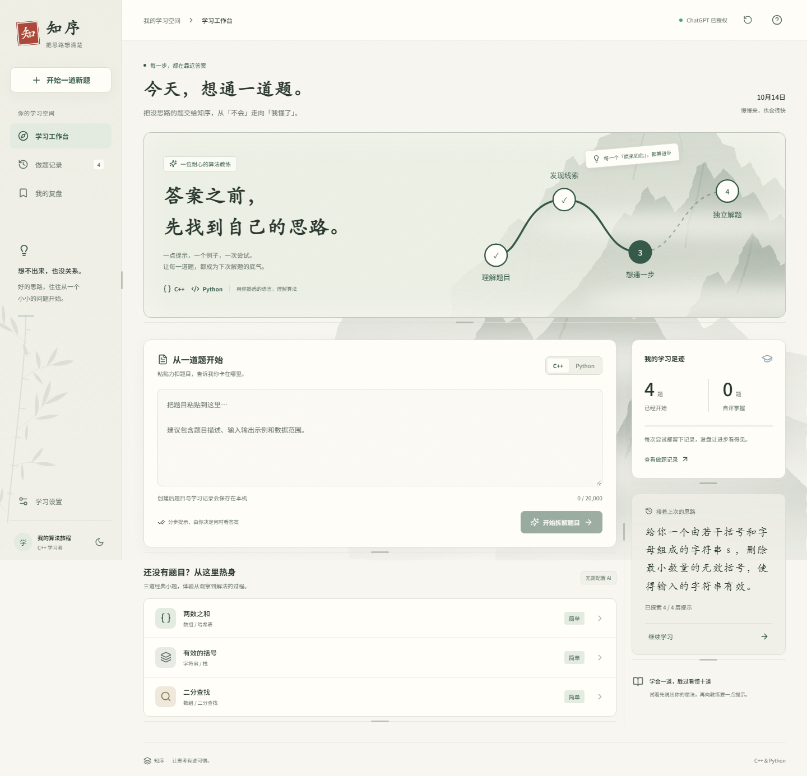
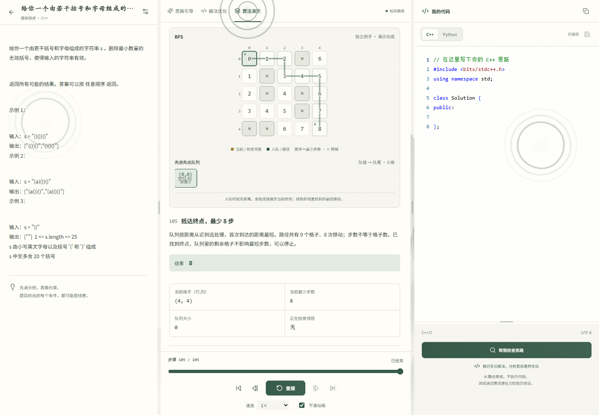
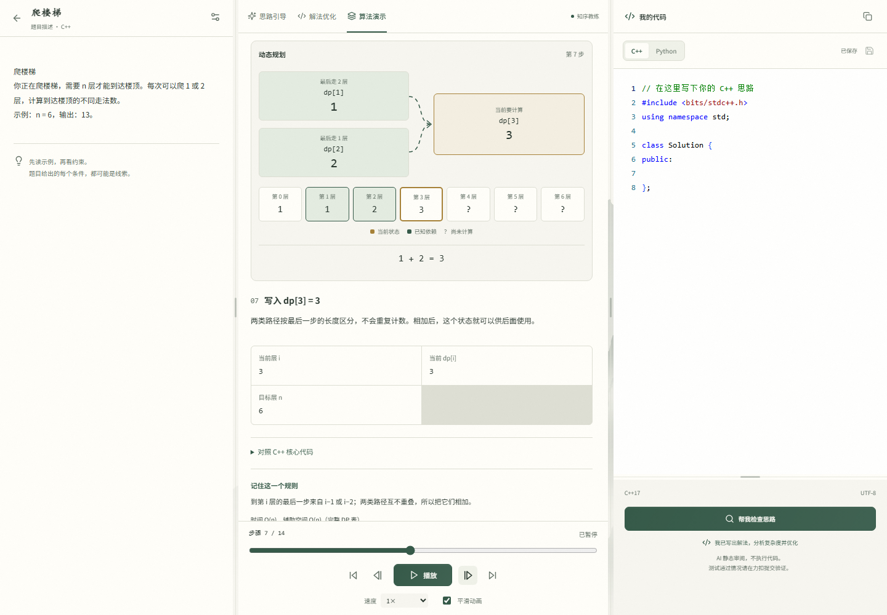
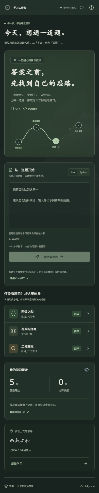

# Zhixu · Algorithm Learning Workbench

A personal, local-first workspace for C++ / Python learners: paste a LeetCode
problem, get step-by-step guidance, try solutions in the editor, and keep your
learning log and review notes. 知序 · 让思路先于答案。

[](https://github.com/baiyujing-rain/zhixu/actions/workflows/ci.yml)
[](LICENSE)

An ink-wash "algorithm study" — paste a problem, walk the guided path from
reading the question to your own solution, with deterministic algorithm
animations along the way.



## Features

- **Four-layer hints** — understanding → naive idea → key insight → pseudocode,
  tuned to your language, foundation, and explanation preferences.
- **Three-pane workbench** with a local Monaco editor, C++ / Python drafts,
  dark mode, and resizable panels:

  

- **Deterministic algorithm demo** — ten classic algorithms rendered
  step-by-step (two pointers, binary search, bracket stack, climbing-stairs DP,
  sliding window, BFS shortest path, merge sort, quick sort, interval greedy).
  No backend or AI required:

  

- **Static demo page** — the same algorithm logic, shipped as a standalone
  zero-dependency page (see Demo below).
- **Offline-first read cache** — recently read sessions, library, examples, and
  profile snapshots are cached in IndexedDB and served when the backend is
  unreachable, with a visible offline hint.
- **Shareable demo links & embed cards** — encode algorithm, inputs, and playback
  position into a URL hash, copy an iframe snippet, and open straight into the
  viewer; malformed links fall back gracefully.
- **Problem knowledge graph** — related same-category algorithms, matched
  practice prompts, and earlier records sharing the same tags are derived on the
  client and shown under each problem.
- **Solution optimization & complexity analysis**, review scheduling (spaced
  repetition), auto-save, JSON backup/restore, and SQLite persistence.
- **Bring your own model** — ChatGPT sign-in, DeepSeek (web transfer or API),
  or any OpenAI Chat Completions-compatible endpoint.

<p align="center">
  
</p>

## Demo

A static, serverless version of the algorithm demo is published with GitHub
Pages:

👉 **https://baiyujing-rain.github.io/zhixu/**

> If the repository is private, GitHub Pages requires a paid plan. See
> `docs/guide.zh-CN.md` for the full note and local build instructions.

## Quick Start

### Docker (one command)

```bash
docker compose up --build
```

Open http://127.0.0.1:3000. The backend listens on 127.0.0.1:8000 and the SQLite
database lives in the `zhixu-data` volume. AI features are optional and the app
degrades gracefully without a configured model.

### Manual

Requires Node.js 20+ and Python 3.11+.

```powershell
# Backend
python -m venv .venv
.\.venv\Scripts\python.exe -m pip install -r backend\requirements.txt
.\.venv\Scripts\python.exe -m uvicorn backend.main:app --host 127.0.0.1 --port 8000

# Frontend (another terminal)
npm install
npm run dev
```

Open http://127.0.0.1:3000.

### Build the static demo

```bash
npm run build:demo
# opens demo/index.html (or serve demo/ with any static file server)
```

## Development

```powershell
npm run typecheck
npm run build
npm run test:algorithms
npm run test:demo-code   # needs g++
.\.venv\Scripts\python.exe -m pytest backend\tests -q
```

## Documentation

- **中文详解（ChatGPT / DeepSeek / API 密钥 / QA / 架构边界）**: [docs/guide.zh-CN.md](docs/guide.zh-CN.md)
- Design & architecture: [docs/](docs/)

## License

[MIT](LICENSE) · © 2026 zhixu contributors
