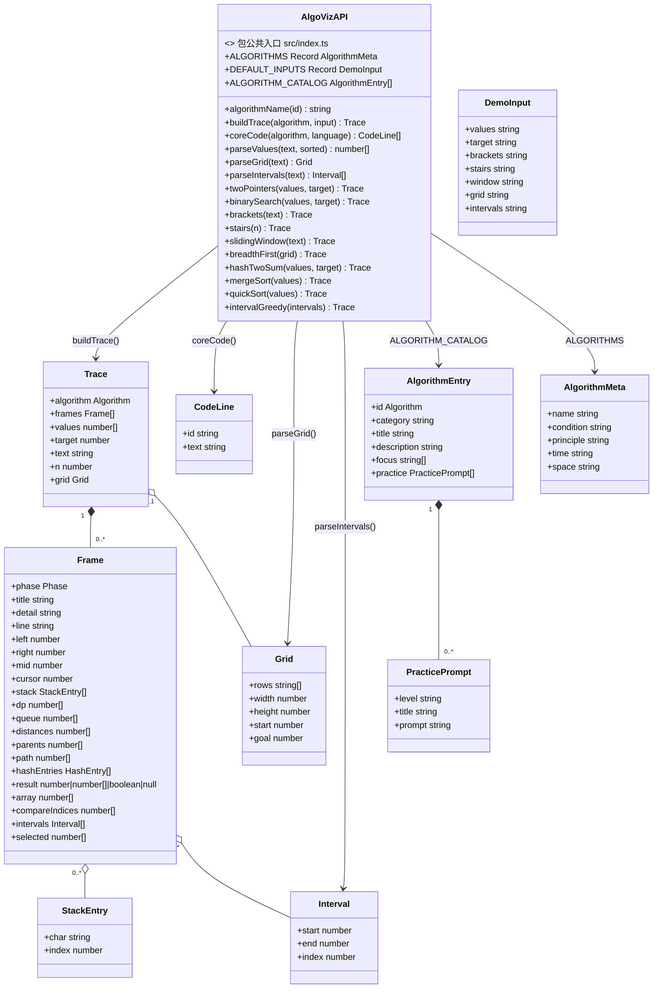
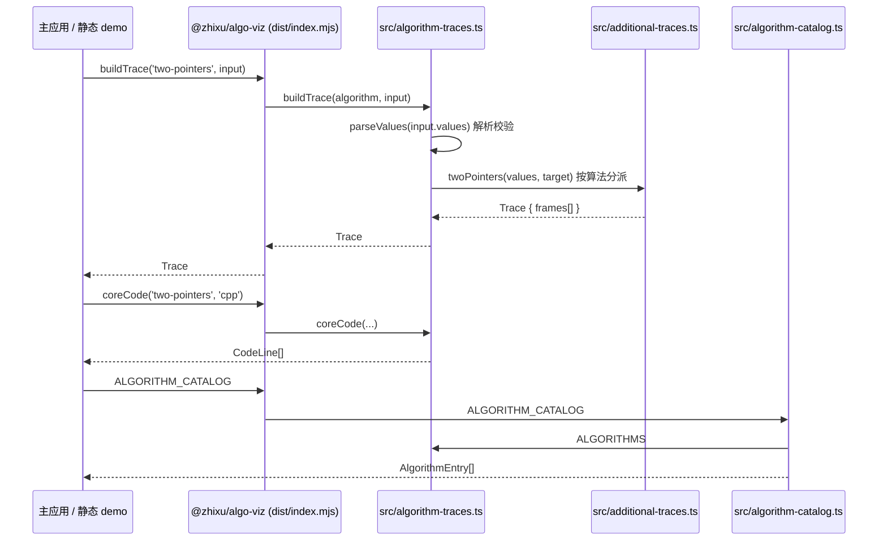
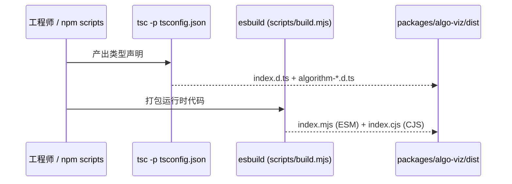
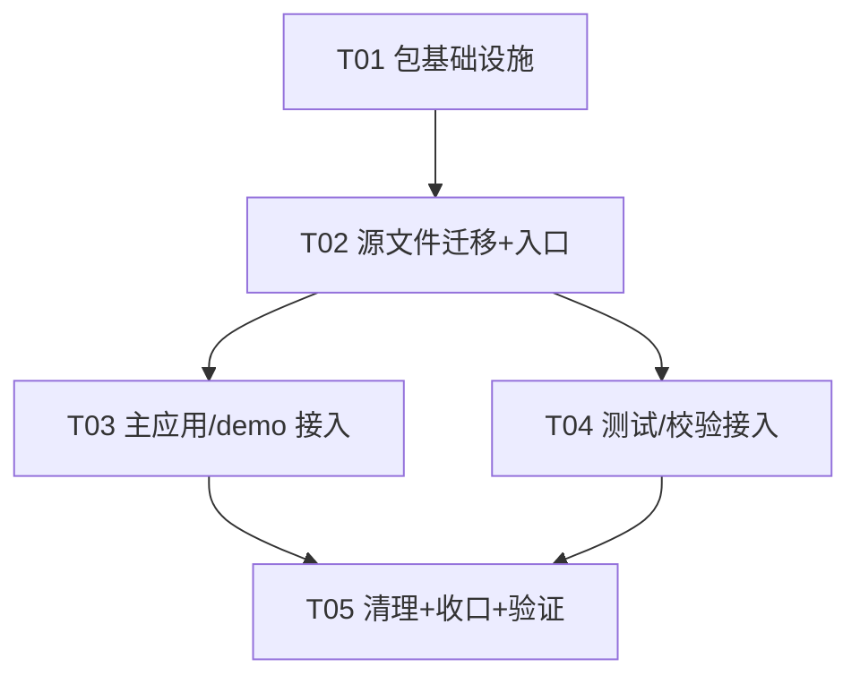

# 智序 · 算法演示抽成独立 npm 包 — 架构与实现方案

> 作者：高见远（架构师）
> 面向：工程师直接实现；QA 据此验证
> 范围：把 `lib/algorithm-traces.ts`、`lib/additional-traces.ts`、`lib/algorithm-catalog.ts` 抽成独立 npm 包，主应用与静态 demo 改为引用该包
> **重要边界：本次只做到「包结构 + 构建 + 本地可验证 + 主应用引用」；发布到公共 npm 是独立步骤，需用户授权 + npm 账号，本方案不执行 publish。**

---

## Part A：系统设计

### 1. 实现方案（Implementation Approach）

#### 1.1 现状与核心难点

| 事实 | 影响 |
|------|------|
| 三个 lib 文件纯 TypeScript、零运行时依赖、只互相引用 + 纯类型 | 天然可独立成包，无需引入任何运行时依赖 |
| 项目为单 app（`name: zhixu`，`private: true`），无 monorepo、无 `packages/` | 需要一次性引入 workspace 结构，而非从已有 monorepo 增量加包 |
| 项目已用 npm（`package-lock.json` lockfileVersion 3） | 用 **npm workspaces** 即可，不必切换到 pnpm/yarn |
| P0 已用 esbuild 把这三文件打包成 `window.ZhixuAlgos`（`scripts/build-demo.mjs` + `demo/demo-entry.ts`） | 证明 esbuild 可直接打包；但 esbuild 不能产出 `.d.ts`，需补 tsc |
| 主应用 `components/algorithm-demo.tsx`、`algorithm-lab.tsx`、`additional-scenes.tsx` 直接 `import` lib 源码 | 抽包后这些 import 必须切换到包名，否则出现"包 + lib 源码"双重维护 |
| `tests/*.test.mjs`、`scripts/verify-demo-code.mjs` 直接编译 lib 源码到 `artifacts/` 再跑 | 抽包后测试/校验脚本要改为引用包，否则继续锁死在旧路径 |

**核心难点**：如何在"不破坏现有 10 算法演示、静态 demo、测试与代码校验"的前提下，把三文件变成一个有独立版本、独立构建、可本地验证、可被主应用以正常依赖方式引用的 npm 包，同时**消除双重维护**。

#### 1.2 抽包方式选型（三方案对比与推荐）

| 维度 | A. monorepo（npm workspaces，建 `packages/algo-viz/`） | B. 单仓独立子目录（相对路径 / npm link） | C. 直接发布 lib 三个文件，不改主应用结构 |
|------|------|------|------|
| 改动量 | 中（移动文件 + 改 import + 加 workspaces） | 中（建目录，但依赖方式脆弱） | 最小（几乎不动主应用） |
| 是否消除双重维护 | ✅ 源码只存在包内，lib 删除 | ⚠️ 若主应用仍 import lib 则仍双份；若 import 子目录则靠相对路径 | ❌ lib 仍是唯一源码，但"包"只是同一份文件的别名，不是真正独立包 |
| 长期维护成本 | ✅ 标准、可独立发版/测试/CI | ⚠️ npm link 换机/CI 易失效，file: 路径丑且难升级 | ❌ 无法独立版本化，发布形态缺失 |
| 是否真能发 npm | ✅ 包结构完整，随时可 publish | ✅ 能，但依赖管理易出问题 | ❌ 需要补包结构才能发 |
| 是否需换包管理器 | ❌ 用 npm 原生 workspaces，无需 pnpm | ❌ | ❌ |

**推荐：方案 A（npm workspaces，非 pnpm）**。理由：

1. 项目已经用 npm（`package-lock.json` lockfileVersion 3 支持 workspaces），**零包管理器迁移成本**；
2. 把三个源文件**物理移入** `packages/algo-viz/src/`，主应用改 import 为 `@zhixu/algo-viz`，`lib/` 下旧文件删除 —— **单一事实来源，彻底避免双重维护**；
3. 包拥有独立 `package.json`/`tsconfig.json`/构建脚本，可独立 `build`/`test`/`npm publish`，满足"独立 npm 包"的真实语义；
4. 静态 demo 也改为消费包，`window.ZhixuAlgos` 与主应用、与外部消费者三者同源。

**明确不推荐 B、C**：B 的 `npm link`/相对路径在换机、CI、`npm ci` 场景易失效且不易升级；C 只是"给 lib 文件贴个包名"，没有独立目录、没有独立版本、发布时仍需重做包结构，属于假抽包。

#### 1.3 关键技术与选型

| 难点 | 选型 | 理由 |
|------|------|------|
| 包结构 | npm workspaces（根 `workspaces: ["packages/*"]`） | 项目已用 npm，零迁移；`npm install` 自动 symlink 到 `node_modules/@zhixu/algo-viz` |
| 运行时产物（ESM + CJS） | **esbuild**（已存在于 devDependencies） | 三文件零运行时依赖，esbuild 单次 bundle 出 `index.mjs` + `index.cjs`，快且自包含；且 P0 已验证 esbuild 可打包 |
| 类型产物（.d.ts） | **tsc**（`declaration + emitDeclarationOnly`） | esbuild 不产出类型；用 tsc 从统一入口 `src/index.ts` 产出 `.d.ts`，保证类型与实现同源、不手写 |
| 主应用消费 | 直接依赖 `@zhixu/algo-viz`，Next 消费预构建 dist | 包发编译后 JS，Next 无需 `transpilePackages`；根脚本 `predev/prebuild` 先构建包，改包源码自动生效 |
| 包名 | 首选 `@zhixu/algo-viz`，备选 `zhixu-algo-viz` | 见 1.4 |

**为什么 esbuild + tsc 配合，而不是二选一**：esbuild 负责"运行时代码"（ESM/CJS 双格式、minify、sourcemap），tsc 负责"类型声明"。二者都从同一个 `src/index.ts` 入口产出，`npm run build` 一条命令串起来，避免手写/复制 `.d.ts` 导致类型漂移。

#### 1.4 包名决策

- **首选 `@zhixu/algo-viz`**：语义清晰、与品牌一致、为未来扩展留空间（`@zhixu/core`、`@zhixu/ui`…）。**前提**：用户在 npm 上拥有/愿意创建 `@zhixu` scope（scoped 包需 scope 所有权）。
- **备选 `zhixu-algo-viz`**：无需建 scope，只需该裸名未被占用（`npm view zhixu-algo-viz` 查）。
- 本方案正文一律以 `@zhixu/algo-viz` 为工作名；若最终用备选名，全局替换包名与 import 即可，其余结构不变。

> 发布时注意：scoped 包默认 `--access restricted`（私有），需 `--access public` 才能公开；本方案在 `publishConfig.access` 预置为 `public`，但**是否真的 publish 由用户后续决定**。

---

### 2. 文件清单（File List）

#### 新建文件

```
packages/algo-viz/package.json               # 包元数据 + exports/main/module/types + build 脚本
packages/algo-viz/tsconfig.json              # 仅用于产出 .d.ts 的构建配置
packages/algo-viz/scripts/build.mjs          # esbuild 构建 ESM + CJS
packages/algo-viz/src/index.ts               # 公共入口，统一 re-export
packages/algo-viz/src/algorithm-traces.ts    # 从 lib/ 移入，内容不变
packages/algo-viz/src/additional-traces.ts   # 从 lib/ 移入，内容不变
packages/algo-viz/src/algorithm-catalog.ts   # 从 lib/ 移入，内容不变
packages/algo-viz/README.md                  # 公共 API 说明（真实 npm 包必需，P1）
```

#### 修改文件

```
package.json                                  # 加 workspaces、@zhixu/algo-viz 依赖、predev/prebuild 等脚本
tsconfig.json                                 # exclude 增加 packages/**，避免根 typecheck 重复处理包
.gitignore                                    # 忽略 packages/*/dist
components/algorithm-demo.tsx                 # import 切换到 @zhixu/algo-viz
components/algorithm-lab.tsx                  # import 切换到 @zhixu/algo-viz
components/additional-scenes.tsx              # import type Frame/Trace 切换到 @zhixu/algo-viz
demo/demo-entry.ts                            # re-export 源切换到 @zhixu/algo-viz
tests/algorithm-traces.test.mjs               # 由编译 lib 产物改为 import 包
tests/additional-traces.test.mjs              # 同上
scripts/verify-demo-code.mjs                  # 同上
scripts/build-demo.mjs                        # 入口不变；视 demo-entry 解析情况微调（一般无需改）
```

#### 删除文件

```
lib/algorithm-traces.ts                       # 移入包后删除，杜绝双重维护
lib/additional-traces.ts
lib/algorithm-catalog.ts
```

> 说明：`lib/` 下其它文件（`dates.ts`、`api.ts`、`problem-library.ts`、`endlesscheng-lists.json` 等）与算法演示无关，**保持不动**。

---

### 3. 数据结构与接口（Data Structures and Interfaces）



> `Algorithm`、`Phase` 是字符串字面量联合类型；`HashEntry` 为 `{ value: number; index: number }`。上述类型全部从 `src/index.ts` 以 `export type` 对外导出。

#### 公共入口 `src/index.ts`（权威导出面）

```ts
export {
  ALGORITHMS, DEFAULT_INPUTS, buildTrace, coreCode, parseValues,
  twoPointers, binarySearch, brackets, stairs,
} from './algorithm-traces';
export type {
  Algorithm, DemoInput, Phase, StackEntry, Frame, Trace, CodeLine,
} from './algorithm-traces';

export {
  slidingWindow, parseGrid, breadthFirst, hashTwoSum,
  mergeSort, quickSort, parseIntervals, intervalGreedy,
} from './additional-traces';
export type { Grid, Interval } from './additional-traces';

export { ALGORITHM_CATALOG, algorithmName } from './algorithm-catalog';
export type { PracticePrompt, AlgorithmEntry } from './algorithm-catalog';
```

该导出面与 P0 的 `window.ZhixuAlgos` 契约完全兼容（`ALGORITHMS / DEFAULT_INPUTS / ALGORITHM_CATALOG / algorithmName / buildTrace / coreCode`），并额外暴露类型与更细粒度的算法函数（这些函数本就被测试引用，公开有利于库使用者与测试）。

#### `packages/algo-viz/package.json` 关键字段

```json
{
  "name": "@zhixu/algo-viz",
  "version": "0.1.0",
  "description": "智序 · 算法演示教学轨迹引擎（纯 TypeScript，零运行时依赖）",
  "license": "MIT",
  "type": "module",
  "sideEffects": false,
  "main": "./dist/index.cjs",
  "module": "./dist/index.mjs",
  "types": "./dist/index.d.ts",
  "exports": {
    ".": {
      "types": "./dist/index.d.ts",
      "import": "./dist/index.mjs",
      "require": "./dist/index.cjs"
    }
  },
  "files": ["dist", "README.md"],
  "publishConfig": { "access": "public" },
  "scripts": {
    "build": "tsc -p tsconfig.json && node scripts/build.mjs",
    "prepublishOnly": "npm run build"
  },
  "devDependencies": {
    "typescript": "^5.8.0",
    "esbuild": "^0.25.0"
  }
}
```

字段说明：

- `main` → CJS（老工具 `require`）；`module` → ESM（打包器）；`types` → 统一 `.d.ts`。
- `exports` 条件导出：`types` 置顶（供 TS 解析）、`import`（ESM）、`require`（CJS），这是现代且兼容 Node ≥ 12 的写法。
- `files` 只发布 `dist` + `README.md`，不带源码/脚本（保持包体积最小、结构干净）。
- `sideEffects: false` 便于主应用 tree-shaking。
- `publishConfig.access: public` 只是预置，**真正 publish 另需用户授权**。

#### `packages/algo-viz/tsconfig.json`（仅产类型）

```json
{
  "compilerOptions": {
    "target": "ES2020",
    "module": "ESNext",
    "moduleResolution": "Bundler",
    "lib": ["ES2020"],
    "strict": true,
    "isolatedModules": true,
    "esModuleInterop": true,
    "skipLibCheck": true,
    "declaration": true,
    "emitDeclarationOnly": true,
    "outDir": "dist",
    "rootDir": "src"
  },
  "include": ["src"]
}
```

> `emitDeclarationOnly` 保证 tsc 只产出 `.d.ts`（`dist/index.d.ts` + 三个模块的 `.d.ts`），不与 esbuild 的 `.mjs/.cjs` 冲突。`moduleResolution: Bundler` 兼容源码里无后缀相对导入 `./additional-traces`。

#### `packages/algo-viz/scripts/build.mjs`

```js
import { build } from 'esbuild';

const shared = {
  entryPoints: ['src/index.ts'],
  bundle: true,
  sourcemap: true,
  target: ['es2020'],
  logLevel: 'info',
};

await build({ ...shared, format: 'esm', outfile: 'dist/index.mjs' });
await build({ ...shared, format: 'cjs', outfile: 'dist/index.cjs' });
```

---

### 4. 程序调用流程（Program Call Flow）

#### 4.1 运行时：消费者调用 `buildTrace`



#### 4.2 构建：`npm run build -w @zhixu/algo-viz`



---

### 5. Anything UNCLEAR（待确认 / 假设）

1. **包名与 scope 归属**：`@zhixu` scope 是否已在 npm 注册、由谁持有，未确认；方案默认用 `@zhixu/algo-viz`，若不行回退 `zhixu-algo-viz`（发布阶段再做 `npm view` 查名）。
2. **是否真的发布到公共 npm**：本次不发布；用户是否想公开、是否走 GitHub Packages / 私有源，待用户后续拍板。
3. **主应用是否要"零构建"热更包源码**：当前方案采用 `predev/prebuild` 先构建包，改包源码后需重启 dev（或手动跑一次 build）。若团队强烈需要"改包源码秒级热更"，可再引入 `transpilePackages` + 直接指 `src` 的 dev 通道，P2 再议，本期不做。
4. **包版本与发版节奏**：首版定为 `0.1.0`；后续是否需要 changesets / 自动发版 CI，未定，本期只用手工 `npm version` + `npm publish` 留口。
5. **`.d.ts` 双格式校验**：建议后续（P2 可选）加 `@arethetypeswrong/cli` 做 `exports`/类型解析自检，本期用 `tsc --noEmit` + 主应用 typecheck 作为够用校验。

---

## Part B：任务分解

### 6. 所需第三方包

```
- typescript@^5.8.0   # 已存在（根 devDependencies），仅产出 .d.ts（无新增）
- esbuild@^0.25.0     # 已存在（根 devDependencies），打包 ESM/CJS（无新增）
```

> **零新增运行时依赖**。npm workspaces 是 npm 内置能力，不引入新包。

### 7. 任务列表（按依赖排序）

| Task | 名称 | 源文件（新建/修改） | 依赖 | 优先级 |
|------|------|------|------|------|
| T01 | 包基础设施：workspaces + 包骨架 + 构建脚本 | 改 `package.json`、`.gitignore`；新 `packages/algo-viz/package.json`、`packages/algo-viz/tsconfig.json`、`packages/algo-viz/scripts/build.mjs` | 无 | P0 |
| T02 | 算法源文件迁移 + 公共入口 | 新 `packages/algo-viz/src/index.ts`、`packages/algo-viz/src/algorithm-traces.ts`、`packages/algo-viz/src/additional-traces.ts`、`packages/algo-viz/src/algorithm-catalog.ts` | T01 | P0 |
| T03 | 主应用与静态 demo 接入包 | 改 `components/algorithm-demo.tsx`、`components/algorithm-lab.tsx`、`components/additional-scenes.tsx`、`demo/demo-entry.ts` | T02 | P0 |
| T04 | 测试与校验脚本接入包 | 改 `tests/algorithm-traces.test.mjs`、`tests/additional-traces.test.mjs`、`scripts/verify-demo-code.mjs`、`scripts/build-demo.mjs` | T02 | P0 |
| T05 | 清理旧 lib + 根 tsconfig 收口 + 全量验证 | 删 `lib/algorithm-traces.ts`、`lib/additional-traces.ts`、`lib/algorithm-catalog.ts`；改 `tsconfig.json`；新 `packages/algo-viz/README.md` | T03、T04 | P1 |

> 每个任务 ≥3 个文件；T03 与 T04 可并行（都只依赖 T02）；T05 收尾依赖二者完成。

#### T01 细节 — 包基础设施

1. 根 `package.json`：
   - 增加 `"workspaces": ["packages/*"]`；
   - `dependencies` 增加 `"@zhixu/algo-viz": "*"`（npm workspaces 自动 symlink 本地包）；
   - 增加/调整脚本：
     - `"predev": "npm run build -w @zhixu/algo-viz"`
     - `"prebuild": "npm run build -w @zhixu/algo-viz"`
     - `"pretest:algorithms": "npm run build -w @zhixu/algo-viz"`
     - `"pretest:demo-code": "npm run build -w @zhixu/algo-viz"`
     - `"typecheck": "npm run build -w @zhixu/algo-viz && tsc --noEmit"`（保证先有 `.d.ts`）
2. `.gitignore` 增加 `packages/*/dist/`。
3. 新建 `packages/algo-viz/package.json`（字段见 3 节）、`tsconfig.json`、`scripts/build.mjs`。

#### T02 细节 — 迁移与入口

1. `git mv`（或等效复制后删原）三文件到 `packages/algo-viz/src/`，**内容不改**。
2. 新建 `src/index.ts`（内容见 3 节），统一 `export type`。
3. 首次运行 `npm install`（生成 workspace symlink）+ `npm run build -w @zhixu/algo-viz`，确认产出 `dist/index.mjs`、`dist/index.cjs`、`dist/index.d.ts`。

#### T03 细节 — 主应用接入

1. `algorithm-demo.tsx`：`import { ALGORITHMS, DEFAULT_INPUTS, buildTrace, coreCode, type Algorithm, type DemoInput, type Frame, type Trace } from '@zhixu/algo-viz'`。
2. `algorithm-lab.tsx`：`ALGORITHM_CATALOG`、`ALGORITHMS`、`type Algorithm` 改自 `@zhixu/algo-viz`。
3. `additional-scenes.tsx`：`import type { Frame, Trace } from '@zhixu/algo-viz'`。
4. `demo/demo-entry.ts`：re-export 源从 `../lib/...` 改为 `@zhixu/algo-viz`。
5. 验证 `npm run build:demo` 仍产出 `demo/algos.js`（`window.ZhixuAlgos`），`demo/demo.js` 无需改。

#### T04 细节 — 测试/校验接入

1. `tests/algorithm-traces.test.mjs`、`tests/additional-traces.test.mjs`：把 `import traceModule from '../artifacts/.../algorithm-traces.js'` 等改为 `import { twoPointers, binarySearch, ... } from '@zhixu/algo-viz'`（ESM 命名导入，来自 `dist/index.mjs`）。
2. `scripts/verify-demo-code.mjs`：`traceModule`/`extraModule` 两个默认导入改为 `import { coreCode, DEFAULT_INPUTS, parseGrid } from '@zhixu/algo-viz'`。
3. `scripts/build-demo.mjs`：入口不变；如 esbuild 解析 workspace 包异常，加 `alias: { '@zhixu/algo-viz': './packages/algo-viz/src/index.ts' }`（一般不需要）。
4. 验证 `npm run test:algorithms`、`npm run test:demo-code` 全绿。

#### T05 细节 — 清理与收口

1. 删除 `lib/` 下三个算法文件。
2. 根 `tsconfig.json` 的 `exclude` 增加 `"packages/**"`（避免根 `tsc --noEmit` 二次处理包源码）。
3. 新建 `packages/algo-viz/README.md`（公共 API + 用法示例）。
4. 全量回归：`npm install` → `npm run build -w @zhixu/algo-viz` → `npm run typecheck` → `npm run test:algorithms` → `npm run test:demo-code` → `npm run build:demo` → `npm run build`（`next build`）→ 视需要跑 Playwright。

---

### 8. 共享知识（Shared Knowledge）

```
- 算法引擎零运行时依赖：包只含纯 TS 编译产物，无任何 dependencies。
- 非法输入统一抛中文 Error（message 面向用户），消费者用 try/catch 承接（主应用 apply() 已有）。
- buildTrace 返回 Trace 是纯数据快照，不执行用户代码/AI，确定且可序列化。
- 产物三件套：dist/index.mjs(ESM) + dist/index.cjs(CJS) + dist/index.d.ts(类型)，缺一不可。
- 单入口原则：所有对外 API 一律经 packages/algo-viz/src/index.ts 导出，禁止消费者深路径 import src 内部文件。
- 版本语义化：0.x 为演进期，破坏性改动 bump minor；发布是独立步骤，需用户授权 + npm login。
- 主应用与 demo 只 import 包名 @zhixu/algo-viz，绝不 import ../packages/... 相对路径（保持单一消费方式）。
- 测试/校验脚本在跑之前必须先 build 包（已用 pre* 脚本保证）。
```

### 9. 任务依赖图（Task Dependency Graph）



---

## 发布步骤（独立、需授权，本期不执行）

仅留口，不纳入本期任务：

1. 用户确认要发布 + 授权 + 提供 npm 账号；
2. `npm view @zhixu/algo-viz` / `npm view zhixu-algo-viz` 查名与 scope 归属；
3. 在 `packages/algo-viz` 下 `npm login`；
4. `npm version 0.1.0`（或首个目标版本）→ `npm run build` → `npm publish --access public`；
5. 主应用后续把根依赖从 `"*"` 收紧为正式版本号。

## 关键风险

1. **npm 授权与 scope**：`@zhixu` scope 需用户拥有；无授权不能发布。→ 本期不 publish，规避。
2. **包名冲突**：`zhixu-algo-viz`/`@zhixu/algo-viz` 可能被占。→ 发布前 `npm view` 核查，必要时换名。
3. **双重维护**：若只复制不删除 lib 会双份漂移。→ 方案强制"移入包 + 删 lib"，T05 收口。
4. **类型与运行时漂移**：手写 `.d.ts` 易错。→ tsc 从同源入口自动产出，禁止手写。
5. **workspace 解析/Next 兼容**：Next 15 消费预构建 dist 无需 `transpilePackages`，但需在 T03/T05 用 `next build` 实测；若 turbopack 对 `exports` 解析异常，回退 `transpilePackages: ['@zhixu/algo-viz']`。
6. **回归风险**：改 import 面广（组件/demo/测试/校验脚本）。→ T05 全量回归脚本兜底。
