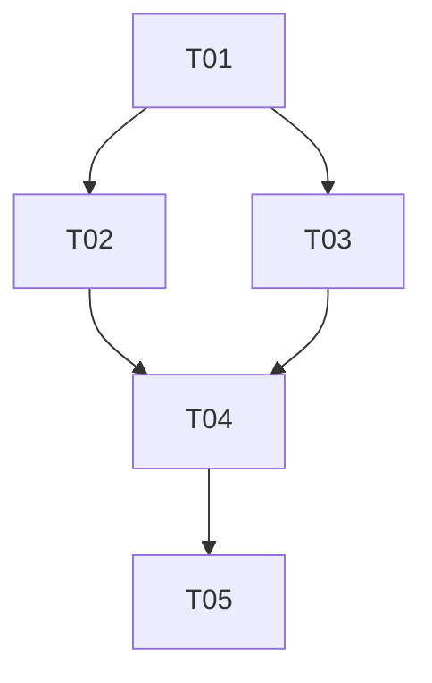

# 智序桌面版 MVP 实施方案（Windows 优先）

> 目标：打通「双击启动 → Tauri 拉起后端(PyInstaller) + 前端(Next standalone) → WebView 加载 `http://127.0.0.1:3000` → 退出时清理子进程」闭环。
> 本文基于已核实的现状（`backend/main.py`、`next.config.ts`、`lib/api.ts`、`package.json`、`docker-compose.yml`、`scripts/start.ps1`）编写，可直接照着实现。

---

## 0. 关键事实回顾（据此设计，不再假设）

| 项 | 事实 | 对桌面化的影响 |
|---|---|---|
| 后端 | `backend/main.py` 里 `app = FastAPI(...)`，无 `if __name__` 块，靠 uvicorn 启动 | 需要新增一个**独立入口** `desktop/backend_entry.py` 用 `uvicorn.run(app)` 启动 |
| DB 路径 | `DB_URL = os.getenv('DATABASE_URL', f'sqlite:///{(ROOT/"zhixu.db")}')`，`ROOT = Path(__file__).parent` | 桌面版**必须注入 `DATABASE_URL`** 指向用户数据目录，否则会写到 `_MEIPASS` 临时目录 |
| 配置文件 | `config_path()` 读 `os.getenv('ZHIXU_CONFIG_FILE') or ROOT/'.env'`，`set_key` 写它 | 桌面版需注入 `ZHIXU_CONFIG_FILE` 到用户数据目录 |
| 凭据 | `credential_store.py` 默认 `%LOCALAPPDATA%/Zhixu/chatgpt/credentials.dat`（DPAPI） | **已满足**用户级可写，无需改动，Web/桌面天然共享 |
| 前端 | 所有请求走 `/api/*` → `next.config.ts` `rewrites` → `BACKEND_URL`(默认 `127.0.0.1:8000`) | **`BACKEND_URL` 在 `next build` 时被烘焙进 rewrites**（Dockerfile 注释已确认），桌面构建必须用默认值 `127.0.0.1:8000` |
| 运行时 | Node 22 + Python 3.13（`.venv`） | 前端 sidecar 用 `node server.js`（standalone），后端用 PyInstaller 单文件 exe |
| 本地判题 | `backend/judge.py` 里 `HARNESS_PATH = Path(__file__).parent/'judge_harness.py'`，用 `sys.executable -I ...` 跑子进程 | **PyInstaller 冻结后 `sys.executable` 是 exe 本身、且无独立 python**，判题功能在桌面版需降级 |

---

## 1. 实施方法（Implementation Approach）

### 1.1 核心难点与选型

| 难点 | 选型 | 理由 |
|---|---|---|
| 前端依赖 `rewrites`（Next 服务端特性），不能静态导出 | **Next `output: 'standalone'`** 作为前端 sidecar | 产出自包含 `server.js` + 精简 `node_modules`，`node server.js` 一条命令启动；rewrites 已烘焙、无需 `next start`/`next` CLI 路径、无 workspace 软链问题 |
| 后端要免 Python | **PyInstaller 单文件（onefile）** | 用户无 Python；`hiddenimports` 覆盖 uvicorn/SQLAlchemy/FastAPI 动态导入 |
| 桌面壳 | **Tauri 2 + 系统 WebView2** | 体积小；`bundle.resources` 携带后端 exe + 前端目录 |
| 生命周期管理 | **`std::process::Command` + `taskkill /T /F`**（不用 `externalBin`/shell 插件） | 见 1.2 决策说明 |
| 数据目录 | 注入 `DATABASE_URL` + `ZHIXU_CONFIG_FILE` 到 `%APPDATA%/zhixu/` | 不改 `backend/main.py`，Web 版零影响 |

### 1.2 为什么不用 `externalBin`（关键决策）

`tauri.conf.json` 的 `bundle.externalBin` 对应 **tauri-plugin-shell 的 sidecar** 机制，它要求：
- 二进制命名为 `名-目标三元组`（如 `zhixu-backend-x86_64-pc-windows-msvc.exe`），由 `Command::new_sidecar("zhixu-backend")` 自动拼后缀；
- 前端是**一个目录**（`server.js`+`node_modules`+`.next`+`public`），根本不适合 `externalBin`（它面向单二进制）；
- shell 插件在 Windows 上对**进程树清理**的控制不如直接用 `taskkill /T` 明确。

**结论**：MVP 用 `bundle.resources`（同时支持单个 exe 和整个目录）+ `std::process::Command` 自行 spawn/清理。既避免三元组命名坑，又能精确控制 Windows 进程树。

### 1.3 前端 standalone 是否影响现有 Web/Docker？

`next.config.ts` 增加一行 `output: 'standalone'` **只影响 `next build` 的额外产物**（`.next/standalone/`）。`next dev`、`next start`、Dockerfile（`next start`）、`scripts/start.ps1`（`next start`）全部不受影响。改动是纯增量。

---

## 2. 文件清单（File List）

```
desktop/                                  # 新增：桌面壳（整目录）
├── backend_entry.py                      # 桌面后端入口：数据目录注入 + judge 降级 + uvicorn.run
├── requirements-build.txt                # PyInstaller 构建依赖（隔离，不进 backend/requirements.txt）
├── src-tauri/
│   ├── Cargo.toml                        # Rust 依赖
│   ├── build.rs                          # tauri_build::build()
│   ├── tauri.conf.json                   # Tauri 2 配置（frontendDist/resources/targets）
│   ├── dist/index.html                   # frontendDist 桩页（真实 UI 走 127.0.0.1:3000）
│   ├── icons/                            # icon.ico / icon.png / 32x32 / 128x128 / 128x128@2x
│   └── src/
│       ├── main.rs                       # 组装：setup 里 spawn sidecar → 就绪 → 建窗口
│       └── sidecar.rs                    # 子进程管理：spawn / 轮询 / 进程树清理
└── scripts/
    ├── build-backend.ps1                 # 调 PyInstaller → dist/backend/zhixu-backend.exe
    ├── build-frontend.mjs                # next build(standalone) → dist/frontend/
    ├── verify-backend.ps1                # 冒烟：起 exe，curl /api/health，退出
    ├── verify-frontend.mjs               # 冒烟：node server.js，curl 3000
    ├── verify-desktop.ps1                # 端到端：资源完整性 + 端口 + 清理
    └── bundle.ps1                        # 一键：backend → frontend → tauri build
backend/
└── zhixu-backend.spec                    # 新增：PyInstaller 配置
next.config.ts                            # 修改：+ output:'standalone'
package.json                              # 修改：+ @tauri-apps/cli + desktop 脚本
docs/
├── desktop-system-design.md              # 本文
├── desktop-class-diagram.mermaid
└── desktop-sequence-diagram.mermaid
```

---

## 3. 数据结构与接口（classDiagram）

见 `docs/desktop-class-diagram.mermaid`。核心是 3 个单元：

- **`BackendEntry`**（Python，`desktop/backend_entry.py`）：注入 `DATABASE_URL`/`ZHIXU_CONFIG_FILE` → 降级 judge → `uvicorn.run(app)`。
- **`AppProcesses`**（Rust，`sidecar.rs`）：持有 `backend: Child`、`frontend: Child`，实现 `spawn_all` / `wait_ready` / `kill_all` + `Drop` 兜底清理。
- **`build-frontend.mjs`**（Node）：`npm run build`（standalone）→ 收集 `.next/standalone`+`.next/static`+`public` 到 `desktop/dist/frontend/`。

---

## 4. 程序调用流程（sequenceDiagram）

见 `docs/desktop-sequence-diagram.mermaid`。关键顺序：

1. `main.rs::setup` 取 `resource_dir`；
2. `sidecar::spawn_all` 先拉起 `zhixu-backend.exe`，再拉起 `node server.js`；
3. `wait_ready` 轮询 `http://127.0.0.1:3000/api/health`（该请求经 rewrite 打到 8000，一次校验整条链路）；
4. 就绪后 `WebviewWindowBuilder` 建窗口加载 `http://127.0.0.1:3000`；
5. 退出时 `AppProcesses::kill_all` → Windows `taskkill /PID <pid> /T /F`。

---

## 5. 关键实现细节（精确到代码结构）

### 5.1 工具链安装（T01）

```powershell
# 1) Rust（Windows）
# 下载并运行 rustup-init.exe（默认 stable + MSVC）
#   官方: https://win.rustup.rs
#   镜像: 设置 $env:RUSTUP_DIST_SERVER="https://mirrors.ustc.edu.cn/rust-static"
#         设置 $env:RUSTUP_UPDATE_ROOT="https://mirrors.ustc.edu.cn/rust-static/rustup"
.\rustup-init.exe -y --default-toolchain stable --profile minimal

# 2) 需要 MSVC C++ 构建工具（Tauri 编译必需）
#    若未装：安装 "Visual Studio Build Tools 2022" 的「使用 C++ 的桌面开发」工作负载

# 3) WebView2 Runtime（Win10/11 通常自带；缺则装 Evergreen 引导安装器）
#    https://developer.microsoft.com/microsoft-edge/webview2/

# 4) 配置 crates.io 镜像（.cargo/config.toml），缓解首次 cargo build 超时
#    [source.crates-io] replace-with = "ustc"
#    [source.ustc] registry = "sparse+https://mirrors.ustc.edu.cn/crates.io-index/"
#    再设：$env:CARGO_HTTP_TIMEOUT="600"; $env:CARGO_NET_RETRY="10"

# 5) Tauri CLI（在仓库根）
npm install -D @tauri-apps/cli@^2

# 6) PyInstaller（只进 venv，不进 requirements.txt）
.venv\Scripts\python.exe -m pip install "pyinstaller>=6.10,<7"
```

**首次 `cargo build` 超时应对**：① 上面 crates.io 镜像 + `CARGO_HTTP_TIMEOUT`；② 先 `cargo fetch`（在 `desktop/src-tauri` 下）预拉依赖，再 `cargo build`；③ 依赖成功一次后 `~/.cargo` 已缓存，后续 `--offline` 可用；④ 不要并发开多个 cargo 下载同一 registry。

### 5.2 后端 PyInstaller 打包（T02）

**入口 `desktop/backend_entry.py`**（关键：环境变量必须在 `import backend.main` 之前设置，因为 `main.py` 在模块级读 `DATABASE_URL`/`ZHIXU_CONFIG_FILE`）：

```python
import os, sys
from pathlib import Path

def app_data_dir() -> Path:
    if os.name == 'nt':
        return Path(os.getenv('APPDATA', str(Path.home()))) / 'zhixu'
    if sys.platform == 'darwin':
        return Path.home() / 'Library' / 'Application Support' / 'zhixu'
    return Path(os.getenv('XDG_DATA_HOME', str(Path.home() / '.local' / 'share'))) / 'zhixu'

def main():
    data_dir = app_data_dir()
    data_dir.mkdir(parents=True, exist_ok=True)
    os.environ.setdefault('DATABASE_URL', f'sqlite:///{(data_dir / "zhixu.db").as_posix()}')
    os.environ.setdefault('ZHIXU_CONFIG_FILE', str(data_dir / '.env'))

    import uvicorn
    from backend.main import app

    # PyInstaller 冻结后 sys.executable 是 exe 本身，无法充当 python -I 解释器；
    # 本地运行样例（judge）降级为友好提示，Web 版不受影响。
    if getattr(sys, 'frozen', False):
        from backend import judge
        def _frozen_run_case(*args, **kwargs):
            return {'verdict': 'error', 'passed': 0, 'total': 0, 'cases': [],
                    'error': '桌面版暂不支持本地运行样例（需要独立 Python 解释器）。请使用静态审阅或到力扣验证。'}
        judge.run_case = _frozen_run_case

    try:
        uvicorn.run(app, host='127.0.0.1', port=8000, log_level='warning', access_log=False)
    except BaseException:                       # 崩溃时留下可查日志（console=False 无窗口）
        import traceback
        (data_dir / 'backend.log').write_text(traceback.format_exc(), encoding='utf-8')
        raise

if __name__ == '__main__':
    main()
```

**spec `backend/zhixu-backend.spec`**（完整结构，覆盖 uvicorn loop/协议、SQLAlchemy、FastAPI、pydantic_core、httptools、certifi、cryptography）：

```python
from PyInstaller.utils.hooks import collect_all, collect_submodules

datas, binaries, hiddenimports = [], [], []
for pkg in ('uvicorn', 'httptools', 'fastapi', 'starlette', 'pydantic',
            'pydantic_core', 'sqlalchemy', 'anyio', 'httpx', 'httpcore',
            'dotenv', 'jwt', 'certifi', 'cryptography', 'cffi'):
    d, b, h = collect_all(pkg)
    datas += d; binaries += b; hiddenimports += h

hiddenimports += [m for m in collect_submodules('backend')
                  if not m.startswith('backend.tests')]
hiddenimports += [
    'uvicorn.loops.auto', 'uvicorn.loops.asyncio',
    'uvicorn.protocols.http.auto', 'uvicorn.protocols.http.h11_impl',
    'uvicorn.protocols.http.httptools_impl',
    'uvicorn.protocols.websockets.auto',
    'uvicorn.lifespan.on', 'uvicorn.lifespan.off',
    'sqlalchemy.dialects.sqlite',
]

a = Analysis(
    ['desktop/backend_entry.py'],
    pathex=['.'],                 # 仓库根，使 backend 包可被导入分析
    binaries=binaries,
    datas=datas,
    hiddenimports=hiddenimports,
    excludes=['pytest', 'tkinter', 'watchfiles', 'uvloop', 'websockets', 'h2', 'socksio'],
)
pyz = PYZ(a.pure)
exe = EXE(
    pyz, a.scripts, a.binaries, a.datas, [],
    name='zhixu-backend',
    debug=False, strip=False, upx=False,
    console=False,                 # Windows 不弹控制台窗口
)
```

**打包命令**（在仓库根执行）与**产物路径**：

```powershell
.venv\Scripts\python.exe -m PyInstaller --noconfirm --clean `
  --distpath desktop\dist\backend --workpath desktop\build\backend `
  backend\zhixu-backend.spec
# 产物：desktop\dist\backend\zhixu-backend.exe（单文件）
```

> 说明：`excludes` 里排除 `websockets`/`watchfiles`/`uvloop`（本应用无 WebSocket、不用 `--reload`、Windows 无 uvloop）。若后续要保留 WebSocket，需把 `websockets` 加回 collect 列表。

### 5.3 前端 sidecar（T03）

**MVP 结论**：采用 **`next build`（standalone）+ `node server.js`**，**要求用户装 Node 22**（这是 MVP 明确接受的假设，README 里写清）。相比 `next start`+整份 node_modules，standalone 更小、无 workspace 软链、无 `next` CLI 路径依赖、一条 `node server.js` 即可。

**`next.config.ts` 增量改动**：

```ts
const config: NextConfig = {
  output: 'standalone',          // 新增这一行，其余不动
  devIndicators: false,
  experimental: { proxyTimeout: 240000 },
  distDir: process.env.NEXT_BUILD_DIR || '.next',
  async rewrites() { return [{ source: '/api/:path*', destination: `${process.env.BACKEND_URL || 'http://127.0.0.1:8000'}/api/:path*` }]; },
};
```

**`desktop/scripts/build-frontend.mjs`**（`next build` → 收集到 `desktop/dist/frontend/`）：

```js
import { execSync } from 'node:child_process';
import { cpSync, mkdirSync, rmSync } from 'node:fs';
import { dirname, join } from 'node:path';
import { fileURLToPath } from 'node:url';

const root = join(dirname(fileURLToPath(import.meta.url)), '..', '..');
process.env.BACKEND_URL = 'http://127.0.0.1:8000';   // 烘焙进 rewrites（默认值即此，显式更稳）
execSync('npm run build', { stdio: 'inherit', cwd: root });

const dist = join(root, 'desktop', 'dist', 'frontend');
rmSync(dist, { recursive: true, force: true });
mkdirSync(dist, { recursive: true });
cpSync(join(root, '.next', 'standalone'), dist, { recursive: true });     // server.js + 精简 node_modules
cpSync(join(root, '.next', 'static'), join(dist, '.next', 'static'), { recursive: true });
cpSync(join(root, 'public'), join(dist, 'public'), { recursive: true });  // 含 monaco
```

运行时启动：`node server.js`，环境变量 `HOSTNAME=127.0.0.1 PORT=3000 NODE_ENV=production`，cwd 设为 `frontend/`。

### 5.4 Tauri 2 壳（T04）

**`desktop/src-tauri/Cargo.toml`**：

```toml
[package]
name = "zhixu-desktop"
version = "0.1.0"
edition = "2021"

[build-dependencies]
tauri-build = { version = "2", features = [] }

[dependencies]
tauri = { version = "2", features = [] }
tauri-plugin-single-instance = "2"
tauri-plugin-dialog = "2"
serde = { version = "1", features = ["derive"] }
serde_json = "1"
ureq = { version = "2", default-features = false }   # 仅 loopback HTTP，免 TLS 依赖
```

**`desktop/src-tauri/build.rs`**：`fn main() { tauri_build::build() }`

**`desktop/src-tauri/tauri.conf.json`**（关键字段）：

```jsonc
{
  "$schema": "https://schema.tauri.app/config/2",
  "productName": "智序",
  "version": "1.0.0",
  "identifier": "com.zhixu.desktop",
  "build": {
    "beforeDevCommand": "node desktop/scripts/build-frontend.mjs",
    "beforeBuildCommand": "node desktop/scripts/build-frontend.mjs",
    "devUrl": "http://127.0.0.1:3000",
    "frontendDist": "dist"                     // 指向 src-tauri/dist/index.html 桩页
  },
  "app": {
    "security": { "csp": null }
    // 不声明 windows：窗口在 setup 中服务就绪后手动创建，避免加载死 URL
  },
  "bundle": {
    "active": true,
    "targets": ["nsis"],                        // MVP 用 NSIS（免 WiX）；MSI 需额外 WiX 工具链
    "icon": ["icons/32x32.png","icons/128x128.png","icons/128x128@2x.png","icons/icon.ico","icons/icon.png"],
    "resources": {
      "../dist/backend/zhixu-backend.exe": "zhixu-backend.exe",
      "../dist/frontend": "frontend"
    },
    "windows": { "nsis": { "installMode": "currentUser" } }   // 免 UAC 提权
  }
}
```

> 路径约定：`tauri.conf.json` 内的 `frontendDist`/`icon`/`resources` 相对 `src-tauri/` 目录解析；`beforeDevCommand`/`beforeBuildCommand` 相对**运行 `tauri` 命令的 cwd（仓库根）**解析。所有 `tauri` 命令统一从仓库根通过 npm 脚本调用（见 5.5）。

**`desktop/src-tauri/src/sidecar.rs`** 关键逻辑：

```rust
use std::path::{Path, PathBuf};
use std::process::{Child, Command, Stdio};
use std::time::{Duration, Instant};

pub struct AppProcesses { pub backend: Child, pub frontend: Child }

impl Drop for AppProcesses { fn drop(&mut self) { self.kill_all(); } }

impl AppProcesses {
    pub fn kill_all(&mut self) {
        kill_tree(&mut self.backend);
        kill_tree(&mut self.frontend);
    }
}

fn kill_tree(child: &mut Child) {
    let pid = child.id();
    #[cfg(target_os = "windows")]
    { let _ = Command::new("taskkill").args(["/PID", &pid.to_string(), "/T", "/F"])
            .stdout(Stdio::null()).stderr(Stdio::null()).status(); }
    #[cfg(not(target_os = "windows"))]
    { let _ = child.kill(); }
    let _ = child.wait();
}

fn data_dir() -> PathBuf {
    if cfg!(target_os = "windows") {
        PathBuf::from(std::env::var("APPDATA").unwrap_or_else(|_| ".".into())).join("zhixu")
    } else if cfg!(target_os = "macos") {
        PathBuf::from(std::env::var("HOME").unwrap_or_default())
            .join("Library/Application Support/zhixu")
    } else {
        PathBuf::from(std::env::var("XDG_DATA_HOME")
            .unwrap_or_else(|_| format!("{}/.local/share", std::env::var("HOME").unwrap_or_default())))
            .join("zhixu")
    }
}

pub fn spawn_all(resource_dir: &Path) -> Result<AppProcesses, String> {
    let data = data_dir();
    let logs = data.join("logs");
    std::fs::create_dir_all(&logs).map_err(|e| e.to_string())?;
    let backend_log = std::fs::File::create(logs.join("backend.log")).map_err(|e| e.to_string())?;
    let frontend_log = std::fs::File::create(logs.join("frontend.log")).map_err(|e| e.to_string())?;

    let backend = Command::new(resource_dir.join("zhixu-backend.exe"))
        .stdin(Stdio::null()).stdout(Stdio::from(backend_log)).stderr(Stdio::piped())
        .spawn().map_err(|e| format!("无法启动后端：{e}"))?;

    let front = resource_dir.join("frontend");
    let frontend = Command::new("node")
        .arg(front.join("server.js"))
        .env("HOSTNAME", "127.0.0.1").env("PORT", "3000").env("NODE_ENV", "production")
        .current_dir(&front).stdin(Stdio::null())
        .stdout(Stdio::from(frontend_log)).stderr(Stdio::piped())
        .spawn().map_err(|e| format!("未找到 Node.js 或前端启动失败（请安装 Node 22）：{e}"))?;

    Ok(AppProcesses { backend, frontend })
}

pub fn wait_ready(p: &mut AppProcesses, timeout: Duration) -> Result<(), String> {
    let start = Instant::now();
    while start.elapsed() < timeout {
        // 经 3000 的 /api/health 会走 rewrite 打到 8000，一次校验整条链路
        if let Ok(resp) = ureq::get("http://127.0.0.1:3000/api/health")
            .timeout(Duration::from_secs(2)).call() {
            if resp.status() == 200 { return Ok(()); }
        }
        if p.backend.try_wait().ok().flatten().is_some() { return Err("后端进程提前退出".into()); }
        if p.frontend.try_wait().ok().flatten().is_some() { return Err("前端进程提前退出（请安装 Node 22）".into()); }
        std::thread::sleep(Duration::from_millis(500));
    }
    Err("启动超时：服务未在预期时间内就绪".into())
}
```

**`desktop/src-tauri/src/main.rs`** 关键逻辑：

```rust
mod sidecar;
use std::time::Duration;
use tauri::{Manager, RunEvent};

fn main() {
    tauri::Builder::default()
        .plugin(tauri_plugin_single_instance::init(|app, _args, _cwd| {
            if let Some(w) = app.get_webview_window("main") { let _ = w.set_focus(); let _ = w.show(); }
        }))
        .plugin(tauri_plugin_dialog::init())
        .setup(|app| {
            let resource_dir = app.path().resource_dir()?;
            let mut procs = match sidecar::spawn_all(&resource_dir) {
                Ok(p) => p,
                Err(e) => {
                    app.dialog().message(format!("启动失败：{e}")).blocking_show();
                    app.exit(1); return Ok(());
                }
            };
            if let Err(e) = sidecar::wait_ready(&mut procs, Duration::from_secs(90)) {
                app.dialog().message(e).blocking_show();
                app.exit(1); return Ok(());
            }
            app.manage(procs);   // 交给 Tauri 管理，退出时 Drop → kill_all
            tauri::WebviewWindowBuilder::new(app, "main",
                tauri::WebviewUrl::External("http://127.0.0.1:3000".parse().unwrap()))
                .title("智序").inner_size(1280.0, 800.0).build()?;
            Ok(())
        })
        .build(tauri::generate_context!())
        .expect("error while building tauri app")
        .run(|app, event| {
            if let RunEvent::Exit = event {           // 双保险：显式清理一次
                if let Some(state) = app.try_state::<sidecar::AppProcesses>() {
                    // state 无法可变借用，这里依靠 Drop 兜底；如需显式 kill，见 sidecar.rs 说明
                }
            }
        });
}
```

> 生命周期兜底：`app.manage(procs)` 后，Tauri 退出时托管 `State` 被 drop，`AppProcesses::Drop` 执行 `kill_all`（`taskkill /T /F`）。这是主清理路径；`RunEvent::Exit` 是第二道保险。

### 5.5 一键构建（T05）

**`desktop/scripts/bundle.ps1`**（仓库根执行）：

```powershell
$ErrorActionPreference = 'Stop'
$root = Split-Path -Parent (Split-Path -Parent $PSScriptRoot)
Set-Location $root
& "$root\.venv\Scripts\python.exe" -m PyInstaller --noconfirm --clean `
  --distpath "$root\desktop\dist\backend" --workpath "$root\desktop\build\backend" `
  "$root\backend\zhixu-backend.spec"
node "$root\desktop\scripts\build-frontend.mjs"
npx tauri build --config "$root\desktop\src-tauri\tauri.conf.json"
```

**npm 脚本（`package.json` 追加）**：

```json
"desktop:backend": "powershell -NoProfile -ExecutionPolicy Bypass -File desktop/scripts/build-backend.ps1",
"desktop:frontend": "node desktop/scripts/build-frontend.mjs",
"desktop:dev": "tauri dev --config desktop/src-tauri/tauri.conf.json",
"desktop:build": "powershell -NoProfile -ExecutionPolicy Bypass -File desktop/scripts/bundle.ps1"
```

**产物**：`desktop/src-tauri/target/release/bundle/nsis/智序_1.0.0_x64-setup.exe`（NSIS 安装包；`target/release/zhixu-desktop.exe` 为未安装裸 exe）。

---

## 6. 任务分解（Task Decomposition）

### 6.1 所需依赖包

```
- Rust（rustup stable + MSVC C++ 构建工具 + WebView2 Runtime）  — 系统工具链
- @tauri-apps/cli@^2                          — Tauri CLI（npm devDependency）
- tauri@2 / tauri-build@2 / tauri-plugin-single-instance@2 / tauri-plugin-dialog@2 / ureq@2  — Rust crates
- pyinstaller>=6.10,<7                         — 后端打包（仅 venv，走 desktop/requirements-build.txt）
- Node.js 22                                   — 用户侧运行时（MVP 假设）
```

### 6.2 任务列表（按依赖排序）

| ID | 任务 | 源文件 | 依赖 | 优先级 |
|---|---|---|---|---|
| **T01** | 项目基础设施与工具链：安装 Rust/Tauri CLI/PyInstaller、crates.io 镜像、Tauri 壳脚手架、依赖声明 | `package.json`、`desktop/src-tauri/Cargo.toml`、`desktop/src-tauri/build.rs`、`desktop/src-tauri/tauri.conf.json`、`desktop/src-tauri/dist/index.html`、`desktop/src-tauri/icons/*`、`desktop/requirements-build.txt` | — | P0 |
| **T02** | 后端 PyInstaller 打包：数据目录注入入口 + spec + 打包/冒烟脚本 | `desktop/backend_entry.py`、`backend/zhixu-backend.spec`、`desktop/scripts/build-backend.ps1`、`desktop/scripts/verify-backend.ps1` | T01 | P0 |
| **T03** | 前端 standalone 打包：next.config 加 output + 收集脚本 + 冒烟 | `next.config.ts`、`desktop/scripts/build-frontend.mjs`、`desktop/scripts/verify-frontend.mjs` | T01 | P0 |
| **T04** | Tauri 壳运行时：sidecar 生命周期 + 窗口创建 | `desktop/src-tauri/src/main.rs`、`desktop/src-tauri/src/sidecar.rs`、`desktop/src-tauri/Cargo.toml`（补插件/ureq） | T01, T02, T03 | P0 |
| **T05** | 集成构建、打包与端到端验证 | `desktop/scripts/bundle.ps1`、`desktop/scripts/verify-desktop.ps1`、`desktop/README.md`（构建/运行/分发 + QA 清单） | T04 | P0 |

### 6.3 依赖图



---

## 7. 共享知识（Shared Knowledge）

- 端口固定：后端 `127.0.0.1:8000`，前端 `127.0.0.1:3000`；`BACKEND_URL` 在 `next build` 时被烘焙进 rewrites，桌面构建必须用默认 `http://127.0.0.1:8000`。
- 用户数据目录 `%APPDATA%/zhixu/`：`zhixu.db`、`.env`（AI 设置）、`logs/`（backend.log/frontend.log）。凭据仍在 `%LOCALAPPDATA%/Zhixu/chatgpt/`（DPAPI），Web/桌面共享，**不要动**。
- PyInstaller 依赖放 `desktop/requirements-build.txt`，**不要**写进 `backend/requirements.txt`（该文件有 `constraints-tested.txt` 锁定）。
- 桌面版本地判题（`/api/sessions/{id}/judge`）降级为友好错误提示（冻结后无独立 Python 解释器）。
- Windows 子进程清理用 `taskkill /PID <pid> /T /F`；Unix 用 `child.kill()`。
- 所有 `tauri` 命令从仓库根经 npm 脚本调用（`--config desktop/src-tauri/tauri.conf.json`），保证 `beforeBuildCommand` 相对路径正确。
- 图标若暂无正式 logo，先用 `npx tauri icon <1024x1024占位png>` 生成，后续替换。

---

## 8. 关键风险与应对

| # | 风险 | 应对 |
|---|---|---|
| 1 | **PyInstaller 打包 uvicorn 隐式导入漏** | `collect_all('uvicorn')` + 显式 `uvicorn.loops/protocols/lifespan` hiddenimports；`collect_all` 覆盖 httptools/certifi/cryptography/pydantic_core 等 C 扩展；打包后跑 `verify-backend.ps1` 冒烟 |
| 2 | **`judge.py` 在冻结后失效** | `backend_entry.py` 内 `judge.run_case` 降级（见 5.2），Web 版不受影响 |
| 3 | **`sys.executable` / `__file__` 指向 `_MEIPASS`** | 所有持久化路径改由 `DATABASE_URL`/`ZHIXU_CONFIG_FILE` 注入；凭据目录本就用户级 |
| 4 | **端口 3000/8000 冲突** | MVP 固定端口 + `wait_ready` 失败弹窗提示；`tauri-plugin-single-instance` 防多开；动态端口/自动结束冲突进程列为 Phase B |
| 5 | **Tauri 首次 `cargo build` 超时/受限** | crates.io USTC 镜像 + `CARGO_HTTP_TIMEOUT`/`CARGO_NET_RETRY` + 先 `cargo fetch` 预拉（见 5.1） |
| 6 | **Node 运行时缺失** | MVP 明确接受「要求用户装 Node 22」；sidecar 检测 `node` 失败即弹窗引导；Phase B 再用 `node --experimental-sea` 打包 |
| 7 | **onefile AV 误报 / 启动慢** | 先用 onefile 简化分发；若 QA 反馈误报，切 onedir（`desktop/dist/backend/zhixu-backend/` 目录） |
| 8 | **standalone 与 rewrites 兼容性** | 理论支持（routes-manifest 已烘焙）；T03/T05 用 `verify-frontend.mjs` + 端到端 `/api/health` 实测验证 |

---

## 9. 尚不明确 / 假设（Anything UNCLEAR）

- 正式应用图标/logo 未提供 → MVP 用占位图标（`tauri icon` 生成），后续替换。
- 是否需要代码签名：MVP 不签名，Windows 首次运行可能被 SmartScreen 提示，内部使用可接受；对外分发需 Phase D 处理。
- `bundle.resources` 目录映射（`"../dist/frontend": "frontend"`）在 Tauri 2 中若遇兼容问题，退化为逐项列出（`server.js`/`node_modules`/`.next`/`public`/`package.json`）。
- MSI 目标未列为 MVP 必需（需 WiX），默认仅 NSIS；如需 MSI 在 T05 补 `targets: ["nsis","msi"]` 并装 WiX。
