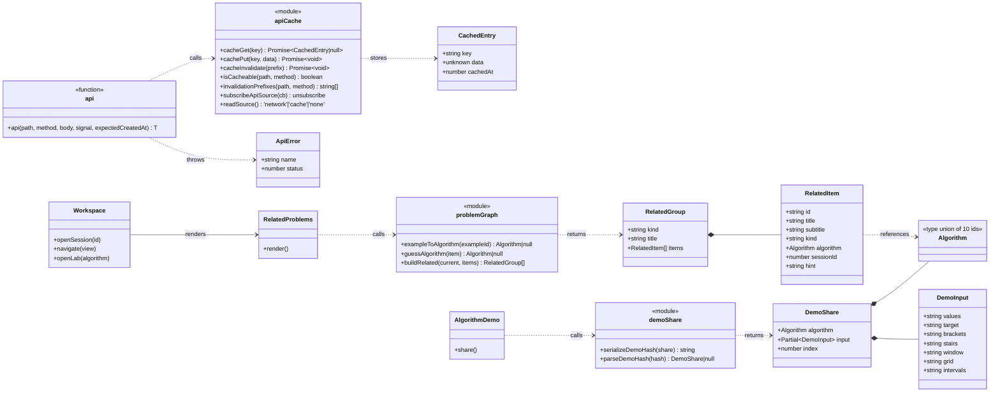
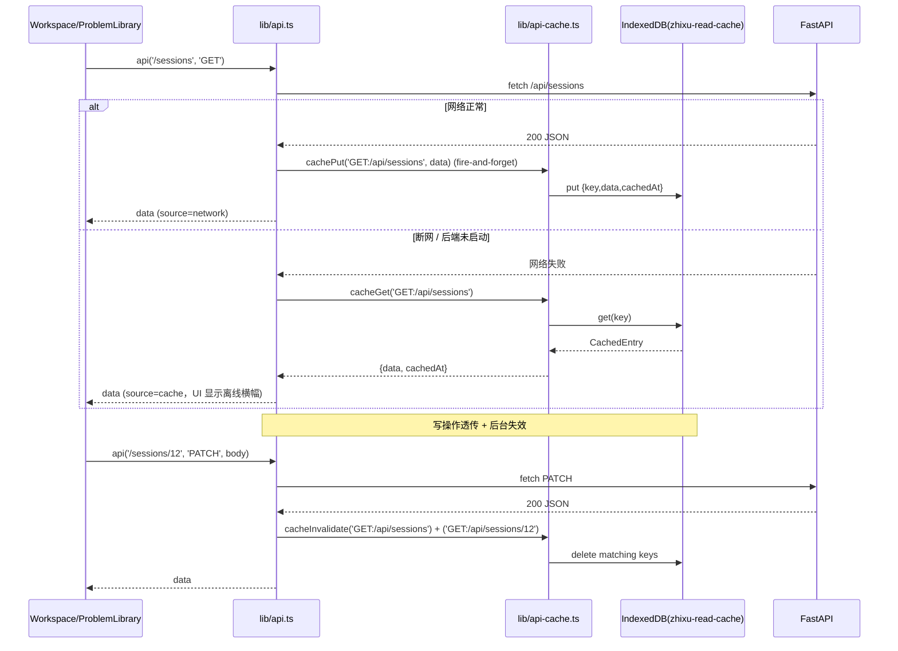
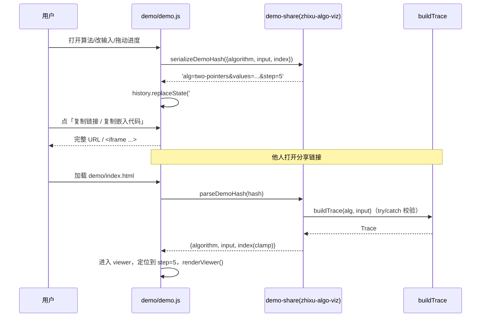
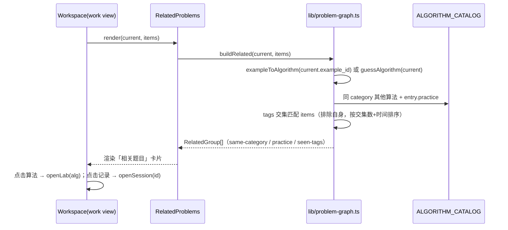
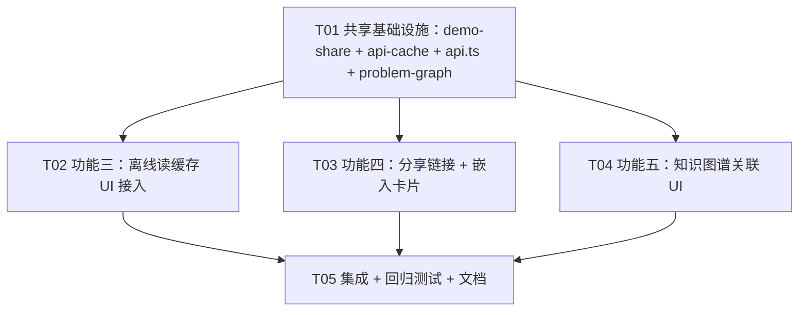

# 智序 · 三大创新功能实现方案（功能三/四/五）

> 作者：高见远（架构师）
> 面向：工程师直接实现；QA 据此验证
> 范围：离线优先读缓存（IndexedDB）、算法演示分享链接 + 嵌入卡片、题目知识图谱关联（相关题 + 前置题）
> 原则：增量开发、最小变更、不破坏现有功能

---

## 0. 现状核实（基于代码，非假设）

| 现状 | 结论 |
|------|------|
| `lib/api.ts` | 唯一的后端请求封装 `api<T>(path, method, body, signal, expectedCreatedAt)`，网络失败抛 `ApiError(status=0)`，非 2xx 抛 `ApiError(status)`。**目前没有任何读缓存**。 |
| `components/use-text-draft.ts` / `use-local-input.ts` | 「断网保留本地副本」= **写侧**（未保存编辑）的 localStorage 草稿 + 版本冲突比较（`expected_code`/`expected_notes` + `X-Zhixu-Record-Created-At`）。**与读缓存无重叠**。 |
| `lib/draft-memory.ts` | 仅内存 Map 兜底（storage 被禁时），非持久化。 |
| `demo/` | 纯静态零依赖；`index.html` 加载 `algos.js`（esbuild 打包 `window.ZhixuAlgos`）+ `demo.js`（IIFE 渲染层，`state` 对象驱动）。**目前没有 URL hash 处理**。 |
| `packages/algo-viz/src/` | `zhixu-algo-viz` npm 包：`ALGORITHMS`/`DEFAULT_INPUTS`/`buildTrace`/`coreCode`/`ALGORITHM_CATALOG`/`algorithmName`，由 `src/index.ts` 汇总导出，`demo/demo-entry.ts` 再导出为 `window.ZhixuAlgos`。**数据/逻辑唯一来源**。 |
| `ALGORITHM_CATALOG` | 10 个算法，`category` 4 类，`practice` 每算法「入门 + 强化」两条，字段为 `{level, title, prompt}`。⚠️ **实际没有「题号/链接」字段**（主理人描述里提到题号/链接，但代码里不存在）。 |
| `backend/examples.py` | 内置示例 id 仅 3 个：`two-sum`、`valid-parentheses`、`binary-search`；tags 分别为 `[数组, 哈希表]`、`[字符串, 栈]`、`[数组, 二分查找]`。 |
| `backend/main.py` `serialize()` | `/api/sessions`（列表）返回含 `tags`、`example_id`、`difficulty`、`status`、`updated_at` 等**不含** content/drafts/messages/notes；`/api/sessions/{id}`（详情）含全部字段。 |
| `components/workspace.tsx` | `initialize()` 并行拉 `/sessions` `/examples` `/profile` `/settings`；`refresh()` 重拉 `/sessions`；`openSession()` 拉 `/sessions/{id}`。`Item` 类型含 `tags/example_id/difficulty/title/status/updated_at/id`。题目详情页 = `view==='work'` 的三栏工作台，左栏 `problem-panel` 展示 `current.title/content/tags`。 |
| `components/problem-library.tsx` | 拉 `/library` 渲染题库；`components/algorithm-lab.tsx` 用 `?view=lab&algorithm=<id>` 打开演示。 |

---

# Part A：系统设计

## 1. 实现方案（Implementation Approach）

### 1.1 功能三：离线优先 + 客户端本地读缓存（local-first）

**核心难点**：断网或后端未启动时，用户仍能读「题目列表 + 最近学习记录」；不引入 PGlite 等重型 WASM；不改业务调用方；与现有「断网保留本地副本」写侧草稿体系不冲突。

**选型**：**原生 IndexedDB + 轻封装**（不引入任何依赖）。IndexedDB 是浏览器内置、容量大、异步非阻塞，适合存整份 JSON 读快照；封装仅 ~100 行，SSR 安全、私密模式降级。

**架构模式**：在 `lib/api.ts` 的 `fetch` 层做 **「读时缓存（read-through）+ 写时透传（write-through）+ 后台失效（background invalidate）」** 的装饰器，业务代码零感知。

**缓存哪些接口**（只缓存「读参考数据」，最小范围）：

| 接口 | 缓存 | 说明 |
|------|------|------|
| `GET /api/sessions` | ✅ | 题目列表 + 最近学习记录（列表摘要） |
| `GET /api/sessions/{id}` | ✅ | 最近学习记录详情（content/drafts/messages/notes） |
| `GET /api/library` | ✅ | 题库列表 |
| `GET /api/library/{id}` | ✅ | 题库题目详情（P1，可选） |
| `GET /api/examples` | ✅ | 内置示例（静态参考，几乎不变） |
| `GET /api/profile` | ✅ | 学习偏好 |
| `GET /api/health` `/api/settings` `/api/leetcode/*` `/api/reviews/*` `/api/sessions/{id}/optimizations` `/api/sessions/{id}/leetcode` | ❌ | 即时状态 / 远端依赖 / 高频变化，不缓存 |

**缓存键**：`key = method + ':' + path`（path 去掉 query、去尾部 `/`）。列表接口本就无有意义 query。

**失效策略**：
- 读：优先走网络；成功 → `cachePut(key, data)`（fire-and-forget）→ 返回新数据。
- 读失败且 `ApiError.status === 0`（断网/后端未启动）→ `cacheGet(key)` 命中则返回缓存（并标记 source=cache），否则照旧抛错。
- 写（POST/PATCH/PUT/DELETE）成功 → 按 `invalidationPrefixes(path, method)` 后台失效相关读缓存（fire-and-forget），**绝不缓存写响应、绝不排队写**。

**失效前缀映射**（最小映射）：

| 写操作 | 失效的读缓存 key |
|--------|------------------|
| `POST /sessions` | `GET:/api/sessions` |
| `PATCH/DELETE /sessions/{id}` | `GET:/api/sessions`、`GET:/api/sessions/{id}` |
| `POST /library`、`DELETE /library/{id}`、`POST /library/{id}/practice` | `GET:/api/library`、`GET:/api/library/{id}` |
| `PUT /profile` | `GET:/api/profile` |

**与现有「断网保留本地副本」衔接（复用而非替代）**：
- **写侧**（未保存代码/笔记/题目输入的本地副本 + 版本冲突）继续由 `use-text-draft.ts` / `use-local-input.ts` 负责，**一行不改**。
- **读侧**（已落库数据的离线可读）由新增读缓存负责，二者存储命名空间不同（IndexedDB `zhixu-read-cache` vs localStorage `zhixu-*` 草稿），互不覆盖。
- 「后台同步」语义：缓存写入/失效全部 `void`（fire-and-forget）不阻塞 UI；写入成功后由现有 `refresh()` 用新数据回填列表缓存。**刻意不做 IndexedDB 写队列**——离线未保存的编辑只属于草稿体系，避免双写源破坏既有「版本冲突先比较再保存」模型。

**IndexedDB 兼容性**：`typeof indexedDB === 'undefined'`（SSR / 隐私模式 / 极老浏览器）→ 内部退化为内存 Map（同 `draft-memory.ts` 策略），接口签名不变、静默 no-op；`open` 捕获 `blocked`/`upgrade`/`error`；单 object store `entries`（keyPath `key`）+ `cachedAt` 索引，写入时按 LRU 上限（如 200 条）+ 30 天懒清理。

### 1.2 功能四：算法演示分享链接 + 嵌入卡片

**核心难点**：把「某算法 + 输入参数 + 播放位置」编码进 URL hash，可分享、可嵌入、健壮可逆；主应用与静态 demo 不重复实现。

**选型**：序列化/反序列化是**纯函数、零依赖**，放进 `zhixu-algo-viz` 包（`src/demo-share.ts`），经 `src/index.ts` + `demo/demo-entry.ts` 同时供 React 与 `window.ZhixuAlgos` 使用 —— 延续「数据/逻辑唯一来源、禁止复制」的既有架构。

**hash 格式**（紧凑、可读、可逆、健壮）：

```
#alg=<algorithmId>&<key>=<encodeURIComponent(value)>&step=<frameIndex>
```

- `alg` 必填，必须是合法 `Algorithm` id。
- 输入键仅包含与 `DEFAULT_INPUTS[algorithm]` **不同**的 `DemoInput` 字段（默认场景链接最短），键白名单 `values|target|brackets|stairs|window|grid|intervals`，值统一 `encodeURIComponent`（安全处理 `,`、空格、`#`、`%`、BFS 网格的 `\n`）。
- `step` 仅当 `> 0` 时出现（整数播放帧位置）。
- 示例：`#alg=two-pointers&step=3`；`#alg=two-pointers&values=1%2C2%2C4%2C7%2C11%2C15&target=15&step=5`。

**反序列化健壮性**：`parseDemoHash` 永远不抛错，非法返回 `null` → 回落到画廊；`alg` 白名单校验；`buildTrace(alg, input)` try/catch 拒绝非法输入；`step` 非整数/越界时 clamp 到 `[0, frames.length-1]`；未知键忽略；总长度 > 2000 拒绝。

**demo.js 加载时解析**：init 时 `parseDemoHash(location.hash.slice(1))`，合法则直接进入 viewer（`state.algorithm/applied/draft/index` + `build()` + `renderViewer()`），非法留在画廊；`syncHash()` 用 `history.replaceState` 在「打开算法 / 应用输入成功 / 用户 seek / 暂停」后同步 hash（**不在自动播放 tick 中写**，避免历史刷屏）。

**嵌入卡**：`#embed=1`（或 `window.self !== window.top`）时给 `body` 加 `.is-embed`，CSS 隐藏站点 header/footer、只渲染 viewer + 「在知序打开 ↗」小链接。分享按钮同时提供「复制链接」与「复制嵌入代码」：

```html
<iframe src="…/demo/index.html#alg=two-pointers&step=3&embed=1" width="720" height="520" style="border:0;border-radius:8px" loading="lazy" allowfullscreen></iframe>
```

**主应用**：`components/algorithm-demo.tsx` 加「分享」按钮，用 `serializeDemoHash({algorithm, input: applied, index})` 生成指向 `demo/index.html#...` 的链接（静态 demo 是唯一可嵌入面）。`algorithm-lab.tsx` 可选加分享（P2）。

### 1.3 功能五：题目知识图谱关联（相关题 + 前置题）

**核心难点**：做完/做一道题后推荐相关题与前置题；数据来自 `ALGORITHM_CATALOG` + `LearningSession.tags` + `example_id`。

**决策：纯前端推导，不新增后端接口。** 理由：单用户本地应用；所需数据（catalog 静态、session 列表 `items` 已含 `tags/title/difficulty/status/updated_at/id`、当前题 `current.tags/example_id`）**全部已在客户端**，后端接口只会增加延迟与维护成本而不产生新数据。

**关联逻辑**（`lib/problem-graph.ts` 纯函数）：

1. **题目 → 算法**：`exampleToAlgorithm(exampleId)`（`two-sum`→`hash-two-sum`，`valid-parentheses`→`brackets`，`binary-search`→`binary-search`，复用现有 `algorithm-demo.tsx` 内联映射）；非示例题用 `guessAlgorithm(item)`（tags/标题命中 catalog 的 title/description/focus/practice 标题，如「哈希表」「栈」「二分」）。
2. **同 category 的其他算法题**：`ALGORITHM_CATALOG` 中 `category` 相同且 `id` 不同的条目（点击 → 打开实验室演示 `/?view=lab&algorithm=<id>`）。
3. **同算法 practice（入门/强化）**：`entry.practice` 的 `title + prompt`（**文本建议**，因 catalog 无题号/链接，不伪造跳转）。
4. **这题用的技巧之前在哪几题见过（前置题）**：遍历 `items`（排除自身），计算 `current.tags ∩ other.tags`，交集非空 → 候选；按「交集数 desc、`updated_at` desc」排序，取前 5，展示「共同技巧：…」（点击 → `openSession(other.id)`）。
5. **难度递进**：同标签候选内，用难度序（简单→中等→困难）做次级排序/「进阶挑战」信号。

**组件落点**：新建 `components/related-problems.tsx`，挂载在 `workspace.tsx` 左栏 `problem-panel` 的 `problem-bottom-note` 之后（不改三栏结构、移动端自然随题目 tab）。标题随状态：「已掌握 → 做完这道题，接着练…」，「学习中 → 相关题目 / 前置题」。

---

## 2. 文件清单（File List）

### 新建

| 相对路径 | 作用 |
|----------|------|
| `lib/api-cache.ts` | 原生 IndexedDB 轻封装 + 读缓存/失效/`source` 订阅（功能三核心） |
| `lib/problem-graph.ts` | `exampleToAlgorithm`/`guessAlgorithm`/`buildRelated` 纯函数（功能五核心） |
| `components/use-api-source.ts` | 订阅读缓存来源（network/cache）的 hook，供离线横幅使用 |
| `components/related-problems.tsx` | 「相关题目」卡片组件（功能五） |
| `packages/algo-viz/src/demo-share.ts` | `serializeDemoHash`/`parseDemoHash`（功能四核心，同源给 demo + React） |
| `tests/demo-share.test.mjs` | 分享 hash 序列化/反序列化/健壮性测试 |
| `tests/problem-graph.test.mjs` | 知识图谱纯函数测试 |

### 修改

| 相对路径 | 改动 |
|----------|------|
| `lib/api.ts` | 抽 `rawApi`，在 `api()` 外层接读缓存/写透传/失效（签名不变） |
| `packages/algo-viz/src/index.ts` | 导出 `serializeDemoHash`/`parseDemoHash` + 类型 |
| `demo/demo-entry.ts` | 再导出分享函数到 `window.ZhixuAlgos` |
| `demo/demo.js` | hash 恢复/同步 + 分享/嵌入按钮 + embed 模式 |
| `demo/demo.css` | `.is-embed` 隐藏 chrome、分享按钮样式 |
| `components/algorithm-demo.tsx` | 加「分享」按钮（主应用入口） |
| `components/algorithm-lab.tsx` | 画廊可选分享（P2） |
| `components/workspace.tsx` | 离线横幅（use-api-source）+ 挂载 `RelatedProblems` |
| `components/problem-library.tsx` | 离线读取来源提示（可选，轻量） |
| `app/globals.css` | `.offline-banner` / `.related-problems` 等水墨风样式 |
| `package.json` | 增加 `test:demo-share` / `test:problem-graph` 脚本（复用 `node --test`） |
| `docs/guide.zh-CN.md` | 三功能使用说明 |
| `README.md` | Feature 列表增补三功能 |

> 无新增第三方依赖；`packages/algo-viz` 改动后由既有 `predev/prebuild` 钩子自动重编译，`demo/algos.js` 由 `npm run build:demo` 重新生成。

---

## 3. 数据结构与接口（classDiagram）



---

## 4. 程序调用流（sequenceDiagram）

### 4.1 功能三：离线读缓存（读时缓存 / 断网回退）



### 4.2 功能四：分享链接生成与加载解析



### 4.3 功能五：相关题 / 前置题推导



---

## 5. 未决事项 / 假设（Anything UNCLEAR）

1. **catalog 的 `practice` 无「题号/链接」**：主理人描述提到「含题号/标题/链接」，但代码里 `practice` 仅 `{level, title, prompt}`。本方案将 practice 相关题按**文本建议**处理（展示题意、不伪造跳转）；若后续要可点击，需在 `PracticePrompt` 增加 `id/url` 字段并回填数据（小改动，可 P2）。
2. **「做完一道题」的触发**：本方案不新增「完成」事件，`RelatedProblems` 卡片**始终可见**、按 `current.status`（mastered/learning）切换标题文案；若后续要精确「完成后才出现」，可再加 `stage>=4` 或 status 条件（一行判断）。
3. **离线缓存命中时的版本一致性**：读缓存只对 `status===0` 的网络失败回退；`use-text-draft.persist()` 失败后的补救 `GET /sessions/{id}` 现在可能命中缓存返回旧数据。既有 `origin()` 与「已删除/编号复用」守卫仍能阻止**错误写入**，最坏情形是一次罕见竞态被短暂标记为已保存，下次保存自愈。已作为**已知低风险**接受，不额外改草稿体系。
4. **分享 hash 不包含语言/播放速度**：`lang`、`speed` 属观看偏好，不入分享状态（保持链接最小）；打开者用各自默认（C++ / 1×）。
5. **嵌入尺寸**：iframe 默认 `720×520`，仅作为建议；`demo.css` 用响应式（`viewer` 已在窄屏自适配），嵌入者可自行改尺寸。

---

# Part B：任务分解（Task Decomposition）

## 6. 所需第三方包（Required Packages）

```
（无新增第三方依赖）
- IndexedDB：浏览器原生，零依赖
- hash 序列化：encodeURIComponent / URLSearchParams，原生
- 知识图谱：纯函数 + 现有 zhixu-algo-viz 数据，零依赖
- 既有依赖不变：next/react/typescript/fastapi/sqlalchemy/httpx/esbuild 等
```

## 7. 任务列表（按依赖排序）

> 上限 5 个任务；每个 ≥ 3 文件；T02/T03/T04 仅依赖 T01（星型，避免长链）。

| Task | 名称 | 源文件 | 依赖 | 优先级 |
|------|------|--------|------|--------|
| **T01** | 共享基础设施（数据/逻辑层） | `packages/algo-viz/src/demo-share.ts`（新）、`packages/algo-viz/src/index.ts`（改）、`demo/demo-entry.ts`（改）、`lib/api-cache.ts`（新）、`lib/api.ts`（改）、`lib/problem-graph.ts`（新） | 无 | P0 |
| **T02** | 功能三：离线优先读缓存 UI 接入 | `components/use-api-source.ts`（新）、`components/workspace.tsx`（改）、`components/problem-library.tsx`（改）、`app/globals.css`（改） | T01 | P0 |
| **T03** | 功能四：分享链接 + 嵌入卡片 | `demo/demo.js`（改）、`demo/demo.css`（改）、`components/algorithm-demo.tsx`（改）、`components/algorithm-lab.tsx`（改） | T01 | P0 |
| **T04** | 功能五：知识图谱关联 UI | `components/related-problems.tsx`（新）、`components/workspace.tsx`（改）、`app/globals.css`（改） | T01 | P1 |
| **T05** | 集成、回归测试与文档 | `tests/demo-share.test.mjs`（新）、`tests/problem-graph.test.mjs`（新）、`package.json`（改）、`docs/guide.zh-CN.md`（改）、`README.md`（改） | T02、T03、T04 | P1 |

### 各任务实现要点

**T01（P0，基础）**
- `demo-share.ts`：`serializeDemoHash(share)` / `parseDemoHash(hash)`，键白名单 + `buildTrace` 校验 + step clamp + 长度上限；`index.ts` 与 `demo-entry.ts` 同步导出。
- `api-cache.ts`：原生 IndexedDB 打开（version 1，store `entries`，keyPath `key`，索引 `cachedAt`），`get/put/invalidate/readSource/subscribeApiSource`；`typeof indexedDB==='undefined'` 退化为内存 Map；LRU 200 条 + 30 天懒清理。
- `api.ts`：抽 `rawApi` 保留原实现；`api()` 对可缓存 GET 做 read-through + cache fallback（仅 `status===0`），对写做透传 + 失效；**签名与异常语义不变**。
- `problem-graph.ts`：`exampleToAlgorithm` / `guessAlgorithm` / `buildRelated`（含难度序）。

**T02（P0）**
- `use-api-source.ts`：`useEffect` 订阅 `subscribeApiSource`，返回 `source`。
- `workspace.tsx`：顶部/`records` 区域加 `.offline-banner`（`source==='cache'` 时提示「当前显示离线缓存」）；`initialize`/`refresh`/`openSession` 无需改逻辑（缓存层透明）。
- `problem-library.tsx`：读取命中缓存时轻提示（可选）。
- `globals.css`：`.offline-banner` 样式。

**T03（P0）**
- `demo.js`：init 解析 hash → 直达；`syncHash()`（openAlgorithm/applyDraft/seek/pause 后 `history.replaceState`，不写 tick）；viewer header 加「分享」按钮（复制链接 + 复制嵌入代码，clipboard + execCommand 回退）；`#embed=1` 或 `window.self!==window.top` 加 `.is-embed`。
- `demo.css`：`.is-embed` 隐藏 header/footer，分享按钮/嵌入小链接样式。
- `algorithm-demo.tsx`：player 选项行加「分享」按钮（`serializeDemoHash` → 复制 `demo/index.html#...` 链接）。
- `algorithm-lab.tsx`：可选画廊分享（P2）。

**T04（P1）**
- `related-problems.tsx`：`useMemo(buildRelated)` → 三组卡片（同分类算法 / 同算法 practice / 之前见过的技巧）。
- `workspace.tsx`：`problem-panel` 底部挂载；`openLab(alg)` = `history.pushState('/?view=lab&algorithm='+alg)` + `setView('lab')`。
- `globals.css`：`.related-problems` 样式。

**T05（P1）**
- 两个 `node --test` 测试文件：hash 往返/非法回退/长度上限；`buildRelated` 分类/tags 交集/排序。
- `package.json` 增 `test:demo-share`、`test:problem-graph` 脚本。
- 更新 `guide.zh-CN.md` / `README.md`。

## 8. 共享约定（Shared Knowledge）

- **API 不变**：`api()` 签名/异常语义保持原样；新增能力全部在内部 + 独立模块，业务组件只在需要时订阅来源。
- **IndexedDB 命名空间**：DB `zhixu-read-cache`，store `entries`；与 localStorage `zhixu-*` 草稿、`zhixu-theme`、`zhixu-animation-*` 等**完全隔离**，不冲突。
- **写侧单写源**：读缓存**只读不回写**；离线未保存编辑仍走 `use-text-draft` localStorage 草稿，避免双写源。
- **分享格式**：hash 一律 `#alg=...&key=encodeURIComponent(value)&step=N`；`parseDemoHash` 永不抛错；自动播放不写 hash。
- **同源不重复**：分享序列化/反序列化只存在于 `zhixu-algo-viz`，demo 与 React 共用；禁止在 `demo.js` 里复制实现。
- **关联推导**：纯前端，依赖 `ALGORITHM_CATALOG`（静态）+ `items`（已加载的 session 列表）+ `current`，不新增后端接口。
- **构建顺序**：改 `packages/algo-viz` 后需 `npm run build -w zhixu-algo-viz`（predev/prebuild 已自动）；静态 demo 需 `npm run build:demo` 重新生成 `demo/algos.js`（该产物不提交）。
- **健壮性底线**：IndexedDB 不可用、hash 非法、tags 为空、无 category 匹配时，全部优雅降级为「无缓存 / 画廊 / 空推荐」，不抛错、不白屏。

## 9. 任务依赖图


