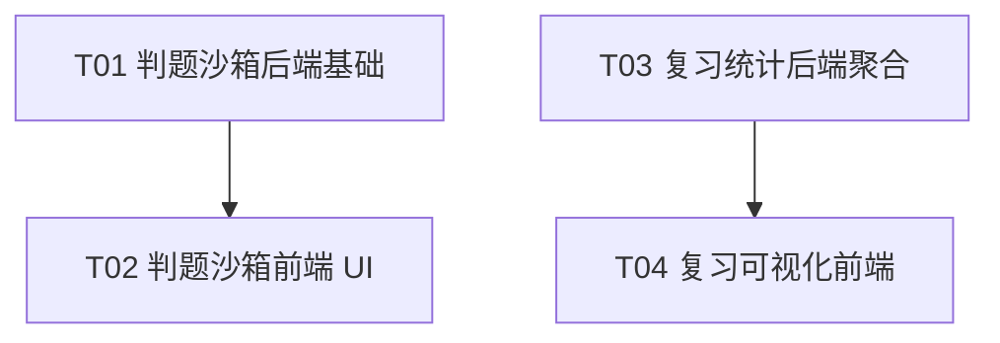

# 智序 · 在线判题沙箱 + 复习记忆曲线/薄弱点雷达 设计文档

> 架构师：高见远。增量开发，最小变更原则，不破坏现有「力扣在线判题 / 解法优化 / 复习计划」能力。
> 已核实现状：`backend/examples.py`、`backend/review.py`、`backend/main.py`、`backend/optimization.py`、`backend/library.py`、`components/judge-panel.tsx`、`components/optimization-panel.tsx`、`components/review-board.tsx`、`components/workspace.tsx`、`lib/api.ts`。
> 运行环境：Python 3.13.7 / Windows（`resource`、`signal.alarm` 均不可用）。

---

## 一、功能一：在线判题沙箱

把「静态 AI 审阅」升级为「可运行验证」——仅对**内置示例题 + Python** 开放，用题目自带的显式用例真实执行用户代码，对比输出，给出「通过/未通过」的**本地、即时、可复现**结果。不连接网络、不写文件、不声称力扣通过。

### 1.1 判题接口设计

新增同步接口（本地沙箱 < 5s，无需像力扣那样异步 job + 轮询）：

**`POST /api/sessions/{id}/judge`**

请求体（`JudgeInput`，Pydantic）：

```json
{
  "language": "python",
  "expected_code": "class Solution:\n    def twoSum(self, nums: list[int], target: int) -> list[int]:\n        ..."
}
```

校验顺序（全部复用现有并发/诚实约定）：

| 条件 | 失败返回 |
|---|---|
| `get_session(id)` 不存在 | 404 |
| `body.language != item.language` | 409「其他窗口已切换题目语言，请刷新后重试」 |
| `body.expected_code != item.drafts.get('python', '')` | 409「当前代码与服务器草稿不同，请先保存你要运行的版本」 |
| `item.example_id` 为空（粘贴题） | 422「仅内置示例题支持本地运行样例；粘贴题请用静态审阅或力扣验证」 |
| `item.example_id` 不在 `EXAMPLES` 或无 `cases` | 422 |
| `item.language != 'python'` | 422「本地运行样例当前仅支持 Python；C++ 请使用静态审阅或到力扣验证」 |
| 代码为空 / 仍是 `starter('python', example_id)` 模板 | 422「请先在编辑器中写入完整解法」 |

成功响应（200）：

```json
{
  "session_id": 1,
  "example_id": "two-sum",
  "language": "python",
  "status": "done",
  "verdict": "accepted",
  "passed": 3,
  "total": 3,
  "cases": [
    {
      "index": 0,
      "input": { "nums": [2, 7, 11, 15], "target": 9 },
      "expected": [0, 1],
      "actual": [0, 1],
      "passed": true,
      "stdout": "",
      "error": null
    }
  ],
  "verification": "本地沙箱运行了内置示例用例，未连接网络、未写入文件，不代表力扣判题结果。"
}
```

`verdict` 取值：`accepted`（全部通过）/ `wrong_answer`（至少一个失败）/ `setup_error`（代码无法加载、缺少 `class Solution` 或目标方法）/ `error`（沙箱自身异常）。

**设计取舍**：判题结果**不持久化**（不建表、不落库）。理由：结果是一次性的「验证」，而非需要回看的历史主张；持久化会诱导「我通过了」的错误认知，违背项目「诚实、不编造」哲学。若未来需要历史，可仿照 `OptimizationReport` 另建表，本期不做。

### 1.2 Python 沙箱策略（核心）

**威胁模型**（明确写入代码注释与文案）：个人本地应用，服务绑定 127.0.0.1，无账号、无多租户。防御目标是「用户**误运行**危险代码」——死循环、超内存、狂打印、误删文件；**不承诺**防御蓄意攻击者（可经 CPython 内部机制逃逸）。据此给出「纵深防御 + 诚实声明残余风险」。

#### 架构：父进程 `subprocess` 拉起子进程 harness，用户代码经 stdin 注入

- 不把用户代码写盘（避免临时文件被恶意引用 / 清理遗漏）。
- 用户代码通过 stdin 以 JSON 传入 `backend/judge_harness.py`，harness 用受限命名空间 `exec` 执行，结果经 stdout 以 JSON 回传，父进程带上限读取。

#### 具体手段

| 威胁 | 手段 | 说明 |
|---|---|---|
| 死循环 / 长时间卡死 | `subprocess.run(..., timeout=4.0)` | **跨平台**，Windows 用 `TerminateProcess`，Linux 用 SIGKILL；这是主防线 |
| 超内存（无限 append 等） | 4s 超时 + 每用例独立进程 | 4s 内分配内存有上界；进程被杀即回收。**硬内存上限需 Windows Job Object / POSIX rlimit，本期不做**（见风险） |
| 递归栈爆炸 | harness 内 `sys.setrecursionlimit(1000)`（默认值，显式固化） | 深递归快速抛 `RecursionError`，不依赖 OS 栈 |
| 狂打印撑爆父进程内存 | 父进程只读 stdout 前 N 字节（cap 64KB），超限即 kill；harness 内 `redirect_stdout` 到 `StringIO` 并截断 | 两层防护 |
| `import os; os.system(...)` 等 | ① `-I` 隔离模式 ② 导入白名单 ③ 危险内建替换 | 见下 |
| 误写项目文件 | `-I` + `cwd=临时目录` + 阻断 `open`/`import os` | 相对路径落到系统临时目录；绝对路径写操作因 `open` 被阻断 |
| 网络外联 | 阻断 `socket`/`urllib`/`http` 等导入 | `-I` 不联网，且导入白名单不含网络模块 |

#### 三个关键决定的落地

**1）`-I` 隔离模式**：以 `[sys.executable, '-I', '-X', 'utf8', str(HARNESS_PATH)]` 启动。
- `-I` = 忽略 `PYTHON*` 环境变量、禁用 user site-packages、Python 3.11+ 同时启用 safe path（不把 cwd / 脚本目录加入 `sys.path`）。
- 效果：用户代码无法 `import backend` / `import main` / 导入 pip 包；即使相对路径写文件也受 `cwd` 约束。
- harness 只用标准库，因此 `-I` 不影响自身运行。

**2）导入白名单（而非封禁 `__import__` 一刀切）**：全封 `__import__` 会让 `from typing import List`、`from collections import deque` 这类正常算法代码误伤。改为在 harness 内给用户命名空间注入自定义 `__import__`：

```
ALLOWED_MODULES = {
  'typing', 'collections', 'math', 'functools', 'itertools',
  'heapq', 'bisect', 're', 'string', 'dataclasses', 'copy', 'operator', 'random'
}
```

非白名单导入抛 `PermissionError('本地运行不允许导入 os 等模块，仅支持纯算法标准库')`，错误经 harness 回传、前端如实展示。

**3）危险内建替换**：用户命名空间的 `__builtins__` 使用 `builtins.__dict__` 的拷贝，并把 `__import__`（指向白名单版）、`open`、`eval`、`exec`、`compile`、`input`、`breakpoint`、`exit`、`quit` 替换为抛 `PermissionError` 的桩函数。`print` 保留（用于调试输出，被 `redirect_stdout` 捕获）。用户命名空间 `__name__ = 'solution'`（避免触发用户自己的 `if __name__ == '__main__'` 测试块）。

> 明确声明：以上是**缓解**不是**沙箱边界**。恶意代码可通过 `object.__subclasses__()` 等逃逸，但属「蓄意攻击」而非本应用的「误运行」威胁模型，文档与 UI 均如实说明。

#### 4）关于 `signal` 超时 / `resource` 内存限制

- **不用 `signal.alarm`**：Windows 无该信号；用 `subprocess.run(timeout=)` 的跨平台实现（这是最稳的）。
- **不用 `resource.setrlimit`**：仅 POSIX 有，当前 Windows 环境不可用。若未来部署 Linux，可在 `preexec_fn` 里补 `RLIMIT_AS/RLIMIT_CPU/RLIMIT_FSIZE` 作为加固，本期留作「已知限制」。

### 1.3 测试用例数据结构（examples.py 改动）

给每个内置示例题**显式补充** `method`（目标方法名）与 `cases`（结构化用例），不再从自然语言解析。这样最小、可靠、可维护。

```python
'two-sum': {
    # ...现有字段不变...
    'method': 'twoSum',
    'cases': [
        {'input': {'nums': [2, 7, 11, 15], 'target': 9}, 'output': [0, 1]},
        {'input': {'nums': [3, 2, 4], 'target': 6}, 'output': [1, 2]},
        {'input': {'nums': [3, 3], 'target': 6}, 'output': [0, 1]},
    ],
},
'valid-parentheses': {
    'method': 'isValid',
    'cases': [
        {'input': {'s': '()[]{}'}, 'output': True},
        {'input': {'s': '([)]'}, 'output': False},
        {'input': {'s': '{[]}'}, 'output': True},
        {'input': {'s': '('}, 'output': False},
    ],
},
'binary-search': {
    'method': 'search',
    'cases': [
        {'input': {'nums': [-1, 0, 3, 5, 9, 12], 'target': 9}, 'output': 4},
        {'input': {'nums': [-1, 0, 3, 5, 9, 12], 'target': 2}, 'output': -1},
        {'input': {'nums': [5], 'target': 5}, 'output': 0},
    ],
},
```

**判定规则**：harness 调用 `getattr(Solution(), method)(**case['input'])`，`passed = (type(actual) is type(output)) and (actual == output)`——严格类型 + 值相等，避免 `True == 1` 这类 bool/int 混淆。

**输入方式说明（对 PRD 的修正）**：LeetCode 风格是 `class Solution` + 方法签名，harness 直接以结构化参数调用，**不需要用户解析 stdin**，比「只喂标准输入」更贴题、更少出错。harness 捕获的 stdout 仅是用户 `print` 的调试输出，不影响判定。

### 1.4 C++ 处理策略

**第一版只对 Python 开放判题，C++ 保持静态审阅。** 理由：
1. C++ 编译 + 执行的原生代码内存/资源限制远难于 Python（Windows 无 rlimit，Job Object 复杂），误运行风险更高；
2. 内置示例题 C++ 解答与 `g++` 编译流程虽存在，但引入「本地编译用户代码」会显著扩大攻击面；
3. 力扣已提供成熟的 C++ 在线 run/submit（现有 JudgePanel），无必要重复造轮子。

落地：`judge` 接口对 `language == 'cpp'` 返回 422 及诚实文案「C++ 暂不支持本地运行，请使用静态审阅或到力扣验证」。前端 LocalJudge 对 C++ 显示禁用态 + 同款说明。

### 1.5 前端「运行样例」按钮位置

**新建 `components/local-judge.tsx`，挂载在代码面板（workspace.tsx）内、现有 `JudgePanel` 之下、『我的代码』标题之上，仅当 `current.example_id` 存在时渲染。**

- 与「力扣测试与提交」（`JudgePanel`，在线）职责分离：内置示例题走本地沙箱，题库力扣题走在线；二者都是可折叠条，互不干扰，互不复用逻辑。
- `LocalJudge` 组件签名：

```ts
<LocalJudge
  sessionId={current.id}
  exampleId={current.example_id}
  language={current.language}
  code={code}
  createdAt={current.created_at}
  onSave={() => saveDraft(true)}
/>
```

交互：折叠条标题「本地运行样例 · 内置示例题」→ 展开后一个「运行样例」按钮（`Play` 图标）→ 先 `onSave()` 拿最新 `drafts[language]` → `POST /sessions/{id}/judge`（带 `expected_code` + `createdAt`）→ 渲染每个用例的通过/未通过、输入/期望/实际、stdout、错误，以及底部诚实声明。运行中 `busy` 态复用 workspace 的 `busy` 机制。

---

## 二、功能二：复习记忆曲线 + 薄弱点雷达图

数据源：`ReviewEvent`（rating / step / interval_minutes / reviewed_at）+ `LearningSession.tags`（JSON list）。纯后端聚合接口 + 前端原生 SVG（水墨风格，复用 `app/globals.css` 现有变量，**不引入新图表库**）。

### 2.1 后端聚合接口设计

新增独立模块 `backend/review_stats.py`（镜像 `optimization.py` / `library.py` 的「模型 + router 工厂」模式），暴露两个**只读** GET 接口，通过 `review_stats_router(db, LearningSession, ReviewEvent, get_session)` 注入依赖。

**① 记忆曲线（单题）`GET /api/sessions/{id}/review-curve`**

```json
{
  "session_id": 1,
  "title": "两数之和",
  "tags": ["数组", "哈希表"],
  "current_step": 1,
  "day_steps": [1, 3, 7, 14, 30],
  "points": [
    { "reviewed_at": "2026-10-13T16:00:00Z", "rating": "good", "rating_ordinal": 2, "step": 1, "interval_minutes": 1440 }
  ]
}
```

- `points` 按 `reviewed_at` 升序（记忆的时序）。
- `rating_ordinal` 映射：`again=0, hard=1, good=2, easy=3`（y 轴档位）。
- 复用 `review.utc()` 输出 ISO 8601；`get_session(id)` 校验存在性与 origin。

**② 薄弱点雷达（全局）`GET /api/reviews/weaknesses`**

```json
{
  "total_events": 12,
  "axes": [
    { "tag": "数组", "event_count": 5, "session_count": 2, "again_count": 2, "again_rate": 0.4, "avg_step": 1.2 }
  ],
  "note": "again 占比越高、平均步数越低，代表该题型越需要巩固。"
}
```

聚合逻辑：遍历 `ReviewEvent` join `LearningSession`，把每条事件计入其 `session.tags` 的**每个**标签（一题多标签时分别计数）；`tags` 为空归入 `"未分类"`。每个标签计算 `event_count`、`session_count`（去重）、`again_count`、`again_rate = again_count / event_count`、`avg_step`（保留 1 位小数）。按 `event_count` 降序、`tag` 名排序，保证前端雷达轴顺序稳定。`again_rate` 即雷达半径值（越大越薄弱）。

### 2.2 前端页面 / 组件设计

**新建两个纯 SVG 组件**（无依赖、无 algo-viz Frame，因为这是简单统计图，Frame 体系面向算法轨迹动画，此处过重）：

- `components/review-curve.tsx` — `MemoryCurve({ points, daySteps })`
  - viewBox 约 `0 0 640 240`，x = 距首次复习的实际时间（或等距索引 + 日期标签），y = `rating_ordinal` 0..3，档位刻度标 `忘了 / 还不熟 / 基本想起 / 很熟悉`。
  - 折线 + 圆点 + 每点标注评分名与日期；点下方标注 `interval_minutes` 换算后的间隔（`10 分钟 / 1 天 / 3 天 / 7 天 …`），直观呈现「衰减→巩固」。
  - 仅 1 个点时渲染单点 + 文案「再复习几次，曲线会慢慢成形」。

- `components/weakness-radar.tsx` — `WeaknessRadar({ axes })`
  - 多边形雷达：中心为原点，半径 = `again_rate`（0..1），同心网格环 0.25/0.5/0.75/1.0，N 条轴 + 标签（tag + 百分比）+ 图例「越靠外越薄弱」。
  - `axes.length < 3` 时降级为横向条形列表（雷达图至少 3 轴才有意义）；`axes` 为空时渲染空态「复习记录还不够，多记录几次自评后再看薄弱点」。

**接线（`components/review-board.tsx`）**：

1. 顶部统计卡（`.review-stats`）之后新增「薄弱点雷达」卡片：在 `load()` 中与 `/reviews` 并行 `Promise.all` 拉取 `/reviews/weaknesses`，`axes.length > 0` 时渲染 `<WeaknessRadar>`。
2. 回想练习弹窗（practice modal）内「最近的复习记录」旁新增「记忆曲线」折叠区：首次展开时按需拉取 `/sessions/{id}/review-curve`，渲染 `<MemoryCurve>`；无记录时给空态文案。

---

## 三、文件清单

### 新建

| 路径 | 作用 |
|---|---|
| `backend/judge.py` | 判题路由工厂 + `run_case()` 沙箱执行器（`JudgeInput`、响应模型） |
| `backend/judge_harness.py` | 子进程安全执行 harness（仅标准库；导入白名单 + 内建替换 + 逐用例执行） |
| `backend/review_stats.py` | 记忆曲线 / 薄弱点雷达聚合路由工厂（只读） |
| `backend/tests/test_judge.py` | 判题接口 + 沙箱单元测试 |
| `backend/tests/test_review_stats.py` | 记忆曲线 / 雷达聚合测试 |
| `components/local-judge.tsx` | 本地「运行样例」折叠面板 + 结果渲染 |
| `components/review-curve.tsx` | 记忆曲线 SVG 组件 |
| `components/weakness-radar.tsx` | 薄弱点雷达 SVG 组件 |

### 修改

| 路径 | 改动 |
|---|---|
| `backend/examples.py` | 每个示例题补 `method` + `cases`（字段向后兼容，不影响现有读取） |
| `backend/main.py` | `include_router(judge_router(...))` 与 `include_router(review_stats_router(...))`（各一行 + import） |
| `components/workspace.tsx` | 代码面板挂载 `<LocalJudge>`，传 `sessionId/exampleId/language/code/createdAt/onSave` |
| `components/review-board.tsx` | 拉取并渲染雷达卡片；practice modal 内接入记忆曲线 |
| `app/globals.css` | 新增 `.local-judge` / `.memory-curve` / `.weakness-radar` 等水墨风样式 |

**无新增 Python 依赖、无 DB 迁移**（判题不落库、复习统计纯读现有表）。

---

## 四、依赖关系与实现顺序（任务分解）

> 增量开发，`main.py` 只做两处**独立的** `include_router` 追加，冲突面极小；`globals.css` 只追加样式。T01 与 T03 相互独立可并行，T02 依赖 T01，T04 依赖 T03。

| 任务 | 名称 | 涉及文件 | 依赖 | 优先级 |
|---|---|---|---|---|
| **T01** | 判题沙箱后端基础 | `backend/examples.py`（改）、`backend/judge_harness.py`（新）、`backend/judge.py`（新）、`backend/main.py`（改）、`backend/tests/test_judge.py`（新） | — | P0 |
| **T02** | 判题沙箱前端 UI | `components/local-judge.tsx`（新）、`components/workspace.tsx`（改）、`app/globals.css`（改） | T01 | P0 |
| **T03** | 复习统计后端聚合 | `backend/review_stats.py`（新）、`backend/main.py`（改）、`backend/tests/test_review_stats.py`（新） | — | P1 |
| **T04** | 复习可视化前端 | `components/review-curve.tsx`（新）、`components/weakness-radar.tsx`（新）、`components/review-board.tsx`（改）、`app/globals.css`（改） | T03 | P1 |

**依赖图**：



**验收要点**：
- T01：`POST /sessions/{id}/judge` 对 `two-sum` 正确代码返回 `accepted`（3/3）；死循环用例 4s 内返回 timeout；`import os` 返回含 `PermissionError` 的失败；C++ 返回 422；`expected_code` 不匹配返回 409。
- T02：内置示例题代码面板出现「本地运行样例」，运行/展示用例结果，粘贴题与 C++ 不出现或禁用态，力扣 JudgePanel 行为不受影响。
- T03：`/reviews/weaknesses` 与 `/sessions/{id}/review-curve` 聚合正确，含 `again_rate`、空标签归「未分类」、时间升序。
- T04：雷达与曲线在 review 页正确渲染，空态/单点/少轴降级正常，现有复习流程（加入/评级/暂停/回想）不回归。

---

## 五、关键约定与风险

1. **诚实哲学一致性**：判题结果页 + 接口 `verification` 字段固定声明「本地沙箱运行了示例用例，未连接网络/未写文件，不代表力扣判题通过」。判题**不持久化、不写回 status/notes**，避免制造「已通过」的长期主张。与现有 `OptimizationReport.verification` 的「未执行代码」表述并存，互不矛盾（一个是静态审阅、一个是本地运行样例）。
2. **沙箱是缓解不是边界**：文档与 UI 如实标注「面向误运行威胁，不防御蓄意攻击」。白名单/内建替换可能被逃逸；`resource` 硬内存上限在 Windows 缺失（仅超时兜底），列为已知限制，若未来上 Linux 再补 rlimit。
3. **不破坏现有功能**：
   - `examples.py` 只**加**字段，`EXAMPLES` 的既有读取（`/api/examples`、`coach` 演示、`starter`）只取白名单字段，不受影响。
   - 判题无写操作、无表，不触碰 `delete_session` 的依赖清理逻辑。
   - `review_stats.py` 只读聚合，不写 `ReviewPlan/ReviewEvent`，复用 `get_session` 的乐观并发/origin 校验；新增接口与现有 `/reviews`、`/sessions/{id}/reviews` 完全并列。
   - 前端本地判题与力扣 JudgePanel 职责分离，不改动 `judge-panel.tsx`；复习可视化只**追加**到 `review-board.tsx` 的空态与弹窗区，不改评分、暂停、加入等既有交互。
4. **性能边界**：判题为同步接口，每用例独立子进程、单用例 4s 超时，内置 3 用例最坏约 12s（前端有 spinner）；正常约 0.3s。复习统计为 O(事件数 × 标签数) 的线性聚合，个人本地数据量下无压力。
5. **Windows 特化**：超时依赖 `subprocess.run(timeout)` 而非 `signal.alarm`；隔离依赖 `-I` 而非 `resource`。测试须在 Windows 下验证（现有 `conftest.py` 用 `TestClient` 即可覆盖接口层；`run_case` 可对 harness 直连 stdin/stdout 做单元测试）。

---

## 附：类图与调用时序

- 类图：`docs/judge-review-class-diagram.mermaid`
- 判题时序：`docs/judge-review-sequence-judge.mermaid`
- 复习统计时序：`docs/judge-review-sequence-review.mermaid`
