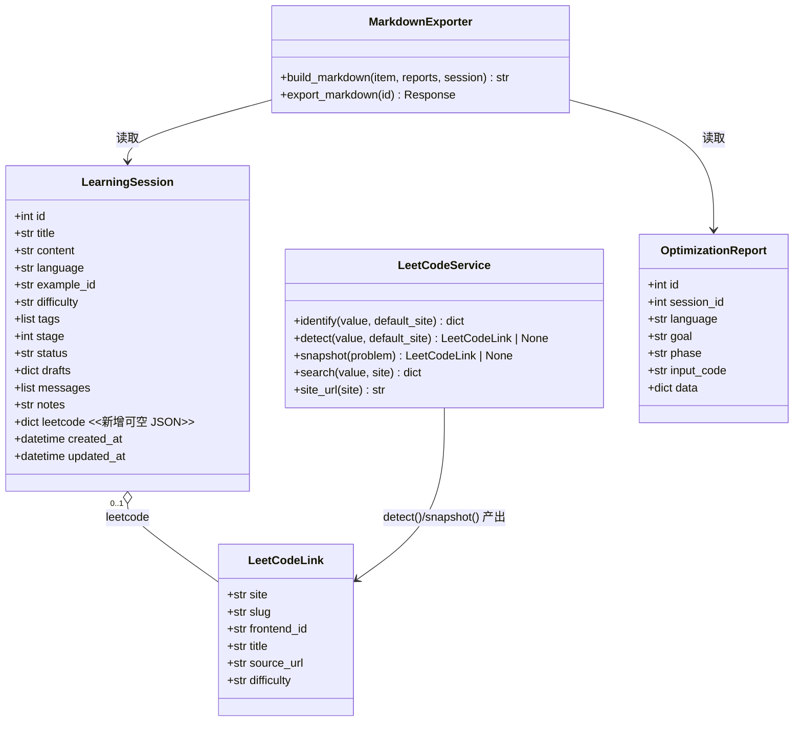
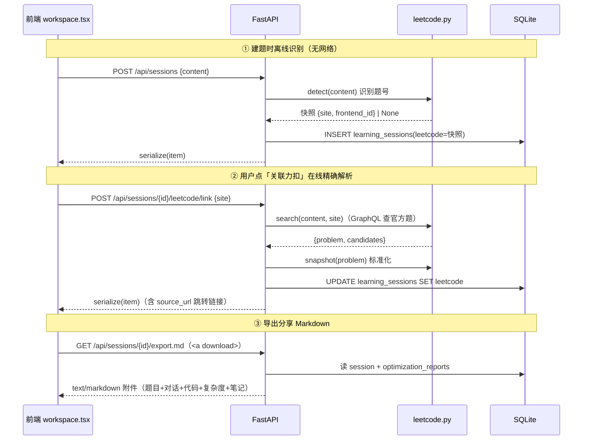
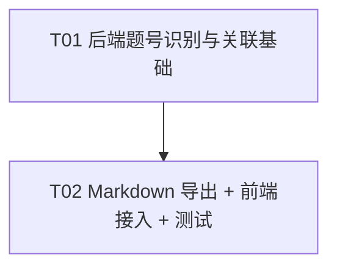

# 智序 · 力扣题号关联 + 笔记导出分享 — 架构与实现方案

> 作者：高见远（架构师）
> 面向：工程师直接实现；QA 据此验证
> 范围：P2 开源传播增强 —— ① 自动识别/关联力扣题号并生成跳转链接；② 把单条学习记录导出为可分享的 Markdown
> 关键现状（已核实）：`backend/leetcode.py` 已有 `identify()`/`search()`/`site_url()`；`backend/library.py` 已有 `LibraryProblem.identity` 与 `/api/library/lookup`；`components/notes-editor.tsx` 已有一个**轻量**的客户端 Markdown 下载（仅标题+复盘笔记+题目+可选代码）；`backend/archive.py` 是**结构化 JSON 备份**，非 Markdown。

---

## Part A：系统设计

### 1. 实现方案（Implementation Approach）

#### 1.1 题号识别与关联

**结论：识别放在后端，分「离线轻量识别」和「在线精确解析」两步；结果以 JSON 快照存到 `LearningSession.leetcode` 新字段。**

理由与分层：

| 环节 | 位置 | 说明 |
|------|------|------|
| 轻量题号识别（无网络） | `backend/leetcode.py` 新增 `detect()` | 复用现有 `identify()` 的正则，纯本地、非致命（识别不到返回 `None`，不阻断建题） |
| 在线精确解析（有网络） | `backend/library.py` 新增 `POST /api/sessions/{id}/leetcode/link` | 复用现有 `leetcode.search()`，把「题号/标题」解析为官方 `slug/source_url/difficulty` 并回填快照 |
| 存储 | `LearningSession.leetcode`（JSON，可空） | 与 `JudgeJob.problem` 快照同模式；支持列表页角标、详情页跳转、Markdown 导出，无需重复查询 |
| 跳转链接 | 快照里的 `source_url` | `leetcode.py.site_url()` 已能拼 `https://leetcode.cn/problems/{slug}/` |

**为什么不用 `LibraryProblem.identity`**：`LibraryProblem` 语义是「我的题库」完整导入（含题面全文 + 判题元数据），关联题号只是「记录一个链接」，把每条做题记录都写进题库会污染题库、语义过重。用独立快照字段更贴合「关联」而非「入库」。

**识别规则（复用现有 `identify()`，能力已具备）**：
- 官方链接：`https://leetcode.cn/problems/two-sum/` / `leetcode.com` → 精确 `slug`
- 纯 slug：`two-sum`（单行、`[A-Za-z0-9]+-[A-Za-z0-9]+`）→ `slug`
- 带题号文本：`1. 两数之和`、`LeetCode 1`、`LC 167`、`力扣 167`、裸 `167` → `frontend_id`
- 普通题目文本（无题号）→ `None`（不误识别、不阻断建题）

**存什么（快照结构）**：
```python
{
  "site": "cn",            # 'cn' | 'com'
  "slug": "two-sum",       # 未解析时为 None
  "frontend_id": "1",      # 题号字符串；slug 场景为 None
  "title": "两数之和",      # 展示用；在线解析后被官方标题覆盖
  "source_url": "https://leetcode.cn/problems/two-sum/",  # 跳转链接；未解析时为 None
  "difficulty": "简单"      # 在线解析后回填
}
```

**cn/com 默认**：默认 `cn`（中文界面，与现有 `identify(default_site='cn')`、`LookupInput.site='cn'` 一致）。解析接口接收 `site` 参数（`cn`/`com`）供用户切换；是否存为全局偏好留作后续，本期不做。

#### 1.2 Markdown 导出

**结论：新增后端接口 `GET /api/sessions/{id}/export.md`，返回 `text/markdown` 附件；前端在题目操作菜单放一个「导出分享」入口。复用 `archive.py` 的数据来源，但**独立实现**（JSON 备份与 Markdown 分享是两种产物，不能耦合）。**

理由：
- 优化报告（复杂度分析）只存在服务端（`OptimizationReport`），前端 `notes-editor.tsx` 拿不到，因此「完整学习过程」必须由后端拼装。
- 后端统一模板，避免在多个组件里重复拼装逻辑。
- `archive.py` 的 JSON 导出是「可恢复备份」（含校验和、全量字段、review 计划），与「可分享 Markdown」（人读、精选字段）目标不同 → 独立实现，仅复用 `LearningSession` / `OptimizationReport` / `get_session` 数据源。

**与 `notes-editor.tsx` 现有下载的关系（避免重复）**：`notes-editor.tsx` 已有一个客户端下载（`download()`，仅「标题+复盘笔记+题目+可选代码」）。它定位是「复盘笔记快速导出」，**保留不动**。新增的后端导出定位是「完整学习记录分享」（题目 + 四层对话 + 双语代码 + 复杂度分析 + 复盘笔记 + 力扣链接），两者互补、不重复。前端「导出分享」按钮指向新接口，不复用也不改造 notes-editor 的下载逻辑。

**Markdown 模板**：
```markdown
# {title}

> - 难度：{difficulty}
> - 语言：{C++ / Python}
> - 状态：{学习中 / 已掌握}
> - 标签：{tag1 / tag2}
> - 力扣：[{frontend_id}. {leetcode.title}]({source_url})   ← 有链接时
> - 导出时间：{exported_at}

## 题目

{content}

## 我的代码

### C++

```cpp
{drafts['cpp']}
```

### Python

```python
{drafts['python']}
```

## 思路过程（与教练的对话）

**你**：{user message}

**教练**：{assistant message}

（遍历 messages，content 已是 Markdown）

## 复杂度分析

（每个 OptimizationReport 一段；含 goal/assessment/summary/current/target/bottlenecks/steps/tradeoffs/checks/proof，refine 阶段附 optimized_code）

## 复盘笔记

{notes 或 '尚未填写复盘笔记。'}
```

#### 1.3 关键技术选型

| 难点 | 选型 | 理由 |
|------|------|------|
| 题号识别 | 复用 `leetcode.identify()` + 新 `detect()` 包装 | 正则已做过安全加固（域名白名单、长度上限、HTTPS 校验），不重复造轮子 |
| 精确解析 | 复用 `leetcode.search()` | 已实现 slug/题号 → 官方题目（GraphQL），返回 `problem + candidates` |
| 存储迁移 | 新增 JSON 列 + 启动时幂等 `ALTER TABLE`（SQLite） | 项目无 Alembic，仅用 `create_all`；加列需显式迁移，做成幂等、对旧库安全 |
| Markdown 导出 | 新 `backend/markdown_export.py` 路由 | 与 archive.py 解耦；读操作、无需 origin 校验也能安全下载 |
| 前端下载 | 原生 `<a href="/api/sessions/{id}/export.md" download>` | Next `rewrites` 会把 `/api/*` 代理到后端；GET 附件无需自定义 header |
| 站点默认 | `cn` | 中文产品 + 既有默认一致；解析接口暴露 `site` 参数 |

---

### 2. 文件清单（File List）

#### 新建文件

```
backend/markdown_export.py                  # Markdown 导出路由（GET /api/sessions/{id}/export.md）
backend/tests/test_leetcode_link_export.py  # pytest：识别/关联/导出 的集成测试
```

#### 修改文件

```
backend/leetcode.py     # 新增 detect()（离线识别快照）+ snapshot()（标准化题面快照）
backend/main.py         # LearningSession 加 leetcode 列 + 启动迁移 + serialize 输出 + 建题时 detect + 注册 markdown 路由
backend/library.py      # practice() 官方题回填 leetcode 快照 + 新增 POST /api/sessions/{id}/leetcode/link
components/workspace.tsx  # Item 类型加 leetcode + 题目操作菜单加「关联力扣/导出分享」+ 跳转链接展示
```

> `components/notes-editor.tsx`、`backend/archive.py` **不改**（前者保留轻量下载，后者保持 JSON 备份语义）。

---

### 3. 数据结构与接口（Data Structures and Interfaces）



#### 后端接口

| 方法/路径 | 请求 | 响应 | 说明 |
|-----------|------|------|------|
| `POST /api/sessions/{id}/leetcode/link` | `{ "site": "cn" \| "com" }` | `serialize(item)` | 在线解析题号并回填 `leetcode` 快照；精确匹配失败时回退离线 `detect()`，不抛错 |
| `GET /api/sessions/{id}/export.md` | 无（GET） | `text/markdown` 附件 | 拼装完整学习记录 Markdown，`Content-Disposition: attachment` |

> 两个接口都走 `get_session`（origin 校验在 `db()` 依赖里，header 可省略；下载用原生 `<a>` 不传 header 也安全，因为 export 是只读）。

#### 关键代码契约

`backend/leetcode.py` 新增：
```python
def detect(value, default_site='cn'):
    """离线识别题号，返回快照 dict 或 None；不因普通文本抛错。"""
    try:
        hint = identify(value, default_site)
    except HTTPException:
        return None
    if hint.get('slug'):
        slug = hint['slug']
        return {'site': hint['site'], 'slug': slug, 'frontend_id': None, 'title': slug,
                'source_url': site_url(hint['site']) + '/problems/' + slug + '/'}
    if not hint.get('number'):
        return None
    title = re.sub(r'^(?:LC|LeetCode|力扣)\s*#?\s*\d{1,6}[.、:：)\s-]*', '', value.splitlines()[0]).strip()
    return {'site': hint['site'], 'slug': None, 'frontend_id': hint['number'], 'title': title, 'source_url': None}

def snapshot(problem):
    """把 parse_problem()/题库 data 标准化为快照；无 slug 返回 None。"""
    if not problem or not problem.get('slug'):
        return None
    return {'site': problem['site'], 'slug': problem['slug'],
            'frontend_id': str(problem.get('frontend_id') or '') or None,
            'title': problem.get('title') or '', 'source_url': problem.get('source_url'),
            'difficulty': problem.get('difficulty')}
```

`backend/main.py` 关键改动：
```python
# LearningSession 增加
leetcode: Mapped[dict | None] = mapped_column(JSON, nullable=True)

# Base.metadata.create_all(engine) 之后，幂等迁移
def migrate_leetcode_column():
    if engine.dialect.name == 'sqlite':
        with engine.begin() as conn:
            cols = [row[1] for row in conn.exec_driver_sql('PRAGMA table_info(learning_sessions)')]
            if 'leetcode' not in cols:
                conn.exec_driver_sql('ALTER TABLE learning_sessions ADD COLUMN leetcode TEXT')
migrate_leetcode_column()

# serialize() 的 base keys 增加 'leetcode'
# create_session() 时：item = LearningSession(..., leetcode=platform.detect(content))
```

`backend/library.py` 关键改动：
```python
# practice()：官方题回填
leetcode = platform.snapshot(data) if data['site'] != 'manual' else None
item = LearningSession(..., leetcode=leetcode)

# 新增
class LinkInput(BaseModel):
    site: Literal['cn', 'com'] = 'cn'

@router.post('/sessions/{id}/leetcode/link')
async def link_session_leetcode(id: int, body: LinkInput, session=Depends(db)):
    item = get_session(id, session)
    result = await platform.leetcode.search(item.content or item.title, body.site)
    problem = result.get('problem')
    snapshot = platform.snapshot(problem) if problem else platform.detect(item.content or item.title, body.site)
    write_session(item, {'leetcode': snapshot}, session)
    session.commit()
    return serialize(item)
```

---

### 4. 程序调用流程（Program Call Flow）



---

### 5. Anything UNCLEAR（待确认 / 假设）

1. **「分享」的最终形态**：本方案按「下载 `.md` 文件，用户自行发社区/博客」实现（零后端托管成本）。若后续要「一键生成公开链接 / 上传到平台」，需再引入发布/托管能力，属独立范围。
2. **cn/com 默认站点**：假设默认 `cn`；是否要把站点偏好写入 `Preference` 本期不做（仅解析接口带 `site` 参数）。
3. **四层思路在 Markdown 中的呈现**：按完整 `messages` 对话时序原样渲染（内容已是 Markdown），不做二次分节；若产品希望「只挑 hint 四层、去掉追问」，可在 `build_markdown` 里加一个 `kind` 过滤，默认不过滤。
4. **题号关联是否进 JSON 备份**：假设不进入 `archive.py` 备份（`leetcode` 链接可从 content 重新识别，且备份保持与旧版本兼容）。如需备份也携带，需 bump 备份 version，本期不做。

---

## Part B：任务分解

### 6. 所需第三方包

```
（无新增依赖。复用现有：fastapi / sqlalchemy / pydantic / httpx / react / lucide-react。）
```

### 7. 任务列表（按依赖排序）

| Task | 名称 | 源文件 | 依赖 | 优先级 |
|------|------|--------|------|--------|
| T01 | 后端题号识别与关联基础 | 改 `backend/leetcode.py`、`backend/main.py`、`backend/library.py` | 无 | P0 |
| T02 | Markdown 导出 + 前端接入 + 测试 | 新 `backend/markdown_export.py`、`backend/tests/test_leetcode_link_export.py`；改 `components/workspace.tsx` | T01 | P0 |

#### T01 细节 — 题号识别与关联

1. `backend/leetcode.py`：新增 `detect()`（离线识别，非致命）与 `snapshot()`（题面标准化）。
2. `backend/main.py`：
   - `LearningSession` 增加 `leetcode` 可空 JSON 列；
   - `create_all` 后增加幂等 `ALTER TABLE` 迁移（SQLite 检查 `PRAGMA table_info`）；
   - `serialize()` 基础字段加入 `leetcode`；
   - `create_session()` 调用 `platform.detect(content)` 写入快照；
   - 注册 `markdown_router`（T02 的模块，本任务可先留 import 占位或 T02 补）。
3. `backend/library.py`：
   - `practice()` 对官方题用 `platform.snapshot(data)` 回填 `leetcode`；
   - 新增 `POST /api/sessions/{id}/leetcode/link` 在线解析并回填。

#### T02 细节 — Markdown 导出 + 前端 + 测试

1. `backend/markdown_export.py`：实现 `build_markdown()` + `GET /api/sessions/{id}/export.md`，按 1.2 模板拼装；代码围栏用「最长反引号 run + 1」的 `fence()` 防止嵌套冲突；文件名做非法字符清洗 + RFC 5987 中文文件名编码。
2. `components/workspace.tsx`：
   - `Item` 类型加 `leetcode?: LeetCodeLink | null`；
   - 题目操作菜单（`focus-actions`）加「关联力扣」按钮（调 link 接口）与「导出分享 Markdown」`<a download>`；
   - 题目头部展示 `leetcode.source_url` 跳转链接（有 `frontend_id` 无 `source_url` 时提示「识别到题号，点击关联获取跳转链接」）。
3. `backend/tests/test_leetcode_link_export.py`：pytest 集成测试覆盖：
   - 「1. 两数之和…」建题 → `leetcode.frontend_id == '1'`、`source_url is None`；
   - 「https://leetcode.cn/problems/two-sum/…」建题 → `slug == 'two-sum'`、`source_url` 非空；
   - `monkeypatch` `leetcode.search` 返回 problem → link 接口回填 `source_url/difficulty`；
   - export.md 返回 200 + `text/markdown` + 内容含标题/题目/复盘笔记；
   - 普通文本建题 → `leetcode is None`（不误识别）。

### 8. 共享知识（Shared Knowledge）

```
- 所有 API 响应沿用现有 {detail} 错误格式（FastAPI HTTPException），成功直接返回数据（非 {code,data,message}）。
- 写操作沿用现有乐观并发：写前带 X-Zhixu-Record-Created-At，write_session() 按 created_at+updated_at 校验防覆盖。
- 题号识别是「非致命增强」：识别不到/网络失败都不得阻断建题或学习主流程。
- leetcode 快照字段：site/slug/frontend_id/title/source_url/difficulty，slug 与 frontend_id 至少其一非空才有意义。
- Markdown 导出是只读 GET，不修改数据库、不强制 origin header（原生 <a download> 可直接用）。
- 代码围栏必须用「最长连续反引号+1」防止代码内含 ``` 时截断。
- 文件名需清洗非法字符，中文名走 filename*=UTF-8'' 编码。
- 默认站点 cn；link 接口显式传 site 可切换 com。
```

### 9. 任务依赖图（Task Dependency Graph）



---

## 关键风险

1. **SQLite 迁移**：`create_all` 不会给旧表加列；必须做幂等 `ALTER TABLE`，否则旧库查询 `leetcode` 列报错。→ T01 明确迁移步骤，`backend/tests` 用新库自动覆盖。
2. **网络解析失败**：`leetcode.search` 依赖力扣 GraphQL，可能 401/404/429/502。→ link 接口失败时回退离线 `detect()` 并返回友好错误，不影响已有记录；建题阶段完全离线，不受影响。
3. **误识别**：普通题目文本可能被 `identify` 当成关键词（但不会产生题号）。→ `detect()` 只在 `number`/`slug` 命中时才返回快照，否则 `None`。
4. **与 notes-editor 重复**：notes-editor 已有轻量下载。→ 明确分工：它管「复盘笔记快速导出」，新接口管「完整学习记录分享」，两者保留。
5. **文件名/围栏注入**：标题含特殊字符、代码含反引号。→ 文件名清洗 + `fence()` 兜底。
6. **前端下载与 origin 校验**：`<a download>` 不带自定义 header，export 必须设计为只读、不强制 origin；link 接口（写）仍走 `api()` 带 header。
