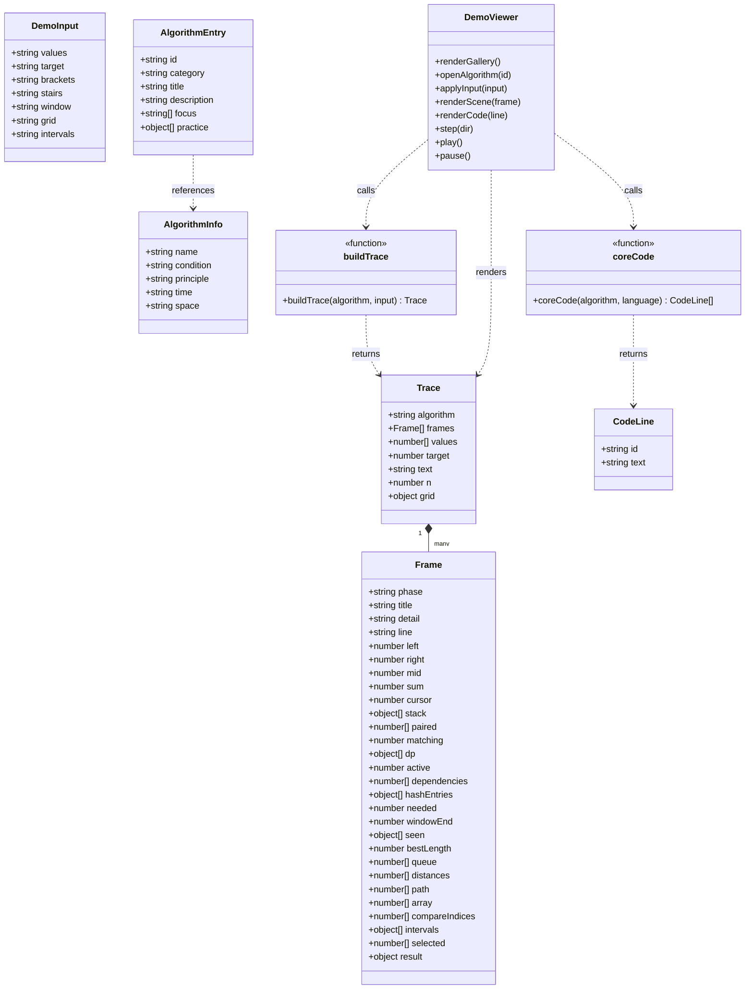
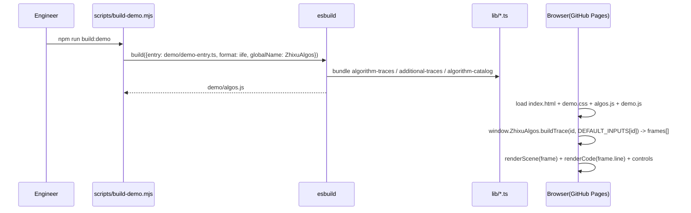
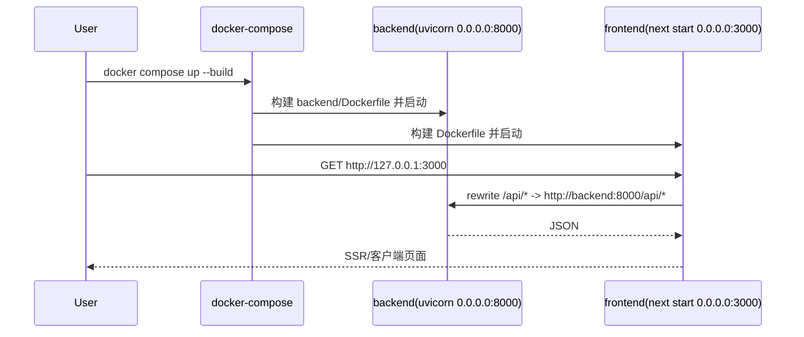
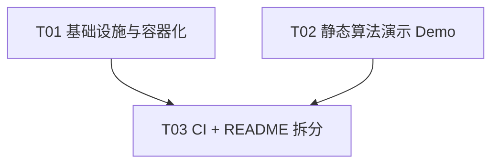

# 智序 · P0 开源传播优化 — 架构与实现方案

> 作者：高见远（架构师）
> 面向：工程师直接实现；QA 据此验证
> 范围：MIT LICENSE、Docker 一条命令启动、CI 流水线、README 拆分、静态算法演示 Demo

---

## Part A：系统设计

### 1. 实现方案（Implementation Approach）

#### 1.1 核心难点与选型

| 难点 | 结论 | 选型/理由 |
|------|------|-----------|
| 一条命令跑起前后端 | 多阶段 Docker 构建 + docker-compose 编排 | 前端 Node 22-alpine 两阶段（build/runtime）；后端 python:3.13-slim（constraints 锁定于 3.13.7） |
| `127.0.0.1` 绑定在容器内失效 | 容器内改绑 `0.0.0.0`，宿主机端口映射仍锁定 `127.0.0.1` | 保住"仅本机可访问"的安全边界，同时让容器间可互相访问 |
| `.env` / DPAPI 凭据 | `.env` 不入镜像、不入库；凭据走卷挂载，Linux 容器自动降级为 0600 文件 | `credential_store.py` 已内置 `os.name != 'nt'` 的 0600 降级路径，Docker/Linux 可跑 |
| 静态 Demo 不依赖后端/AI | 复用 `lib/` 纯 TS 算法逻辑，esbuild 打包成单一 IIFE；渲染层用原生 HTML+JS 轻量实现 | 见 1.2（本方案最关键决策） |
| CI 无浏览器 | 默认只跑 typecheck + test:algorithms + pytest；E2E 改为 workflow_dispatch 手动触发 | Playwright 需要浏览器 + 双端，P0 不纳入默认流水线 |

#### 1.2 静态 Demo 的关键决策（推荐方案）

**推荐：新建一个纯静态 HTML + JS 独立页面，用 esbuild 把现有 `lib/` 里的算法数据/逻辑打包成一个浏览器全局对象，渲染层用原生 JS 轻量实现。**

理由（对照 GitHub Pages 只能托管静态文件）：

1. **GitHub Pages 无 Node/Next 运行时**。若复用 React 组件走 `next build` + `output: 'export'`，需要再维护一套 Next 构建链，且现有 `next.config.ts` 的 `rewrites`（`/api` 代理）与 `experimental.proxyTimeout` 会和 `output: 'export'` 冲突，必须做条件分支或另起最小 Next 工程，复杂度不低、收益有限。
2. **算法的"难点"在数据/逻辑，不在渲染**。`lib/algorithm-traces.ts`（`buildTrace` 生成逐步帧、`coreCode` 生成 C++/Python 代码）、`lib/additional-traces.ts`（10 个算法的确定性 trace）、`lib/algorithm-catalog.ts`（10 个算法目录）三者互引只用相对路径 + 纯类型导入，**零 React / 零后端 / 零 AI 依赖**。esbuild 可直接把它们打包成一个 `window.ZhixuAlgos`，保证"演示数据与主应用完全同源"，不复制任何逻辑。
3. **渲染层虽要重写，但很薄**。`Frame` 已含全部状态（`left/right/mid`、`stack/paired`、`dp`、`queue/distances/path`、`intervals/selected` 等），原生 JS 只需"把帧映射成 SVG + 高亮对应代码行 + 播放/步进控件"，约 500~700 行，自包含、零依赖、体积极小。
4. **可独立构建、独立部署**。`npm run build:demo` 只产出 `demo/algos.js`；`demo/` 目录即 GitHub Pages 站点根目录，无需 SSR、无需 rewrite、无需后端。

**取舍与备选**：此方案会让渲染层（SVG 场景）与主应用 `components/algorithm-demo.tsx` 存在一份**实现重复**（逻辑不重复，视觉需人工对齐）。若后续对"视觉与主应用 100% 像素一致"有强诉求，再切换为"最小 Next 静态导出工程（复用现有 3 个 React 组件 + `app/globals.css`）"，P0 阶段不做。

**打包契约（`window.ZhixuAlgos`）**：

```ts
ZhixuAlgos = {
  ALGORITHMS,          // Record<Algorithm, {name, condition, principle, time, space}>
  DEFAULT_INPUTS,      // Record<Algorithm, DemoInput>
  ALGORITHM_CATALOG,   // AlgorithmEntry[]（画廊/目录）
  algorithmName,       // (id: string) => string
  buildTrace,          // (algorithm, input: DemoInput) => Trace（非法输入抛中文 Error）
  coreCode,            // (algorithm, language: 'cpp'|'python') => CodeLine[]（{id,text}）
}
```

#### 1.3 Docker 双环境组织

- **前端**：`node:22-alpine` 两阶段。build 阶段 `npm ci` → `next build`；runtime 阶段仅拷贝 `node_modules`、`.next`、`public`、`next.config.ts`、`package.json`。
- **后端**：`python:3.13-slim` 单阶段。先 `pip install -r requirements.txt`（`requirements.txt` 首行已有 `-c constraints-tested.txt`），再拷贝 `backend/` 源码。
- **网络**：前端通过 Next `rewrites` 把 `/api/*` 代理到 `http://backend:8000`（compose 服务名解析）；宿主机仅暴露 `127.0.0.1:3000` 与 `127.0.0.1:8000`。

---

### 2. 文件清单（File List）

#### 新建文件

| 相对路径 | 作用 |
|----------|------|
| `LICENSE` | MIT 协议 |
| `.dockerignore` | 缩小构建上下文、排除密钥与生成物 |
| `Dockerfile` | 前端多阶段镜像 |
| `backend/Dockerfile` | 后端镜像 |
| `docker-compose.yml` | 一键编排前后端 |
| `.github/workflows/ci.yml` | typecheck + test:algorithms + pytest（E2E 手动可选） |
| `.github/workflows/pages.yml` | （可选 P2）构建并发布静态 Demo 到 GitHub Pages |
| `scripts/build-demo.mjs` | esbuild 打包 `lib/` → `demo/algos.js` |
| `demo/demo-entry.ts` | 从 `lib/` 再导出的入口（esbuild entry） |
| `demo/index.html` | 静态 Demo 外壳 |
| `demo/demo.css` | 静态 Demo 样式 |
| `demo/demo.js` | 静态 Demo 渲染器（画廊 + 场景 + 控件） |
| `docs/guide.zh-CN.md` | 承接原 README 的中文详解（ChatGPT/DeepSeek/API/QA/架构） |

#### 修改文件

| 相对路径 | 改动 |
|----------|------|
| `README.md` | 重写为英文首屏 + 徽章 + Quick Start + 文档链接 |
| `package.json` | 增加 `"build:demo": "node scripts/build-demo.mjs"`；devDependencies 增加 `esbuild` |
| `.gitignore` | 追加 `demo/algos.js`（生成物） |

> `demo/algos.js` 为构建产物，不提交；由 `build:demo` 或 CI/Pages 流水线生成。

---

### 3. 数据结构与接口（classDiagram）



> 说明：`DemoViewer` 即 `demo/demo.js` 的运行时对象，消费 `window.ZhixuAlgos`（由 `buildTrace`/`coreCode`/`ALGORITHM_CATALOG` 等组成）。

---

### 4. 程序调用流（sequenceDiagram）

#### 4.1 静态 Demo 构建与运行



#### 4.2 Docker 一条命令启动与请求链路



---

### 5. 未决事项 / 假设（Anything UNCLEAR）

1. **GitHub Pages 与 Private 仓库**：仓库当前为 `baiyujing-rain/zhixu`（Private）。GitHub Pages 对私有仓库需要付费套餐（Pro/Team/Enterprise）。若想免费发布 Demo，需将仓库转 Public。**P0 先把 `pages.yml` 与 `build:demo` 准备好，发布动作由主理人决定仓库可见性后再执行。**
2. **视觉一致性取舍**：静态 Demo 的 SVG 渲染是轻量重写，与 `components/algorithm-demo.tsx` 视觉近似而非逐像素一致。如需完全一致，后续切换为 Next 静态导出（备选方案，见 1.2）。
3. **Docker 内 AI/OAuth**：默认不携带 `.env`，容器内 AI 未配置 → 后端走"无模型提示 + 算法演示"降级路径，不影响核心功能。ChatGPT OAuth 凭据在 Linux 容器内降级为 0600 文件（非 DPAPI），若需持久化 OAuth 需挂载 `ZHIXU_AUTH_DIR` 卷。
4. **E2E 不进默认 CI**：Playwright 需浏览器 + 前后端联调，P0 以 `workflow_dispatch` 手动触发占位，不在 `push`/`PR` 默认执行。

---

## Part B：任务分解（Task Decomposition）

> 与团队任务对齐：工程师任务 #2（实现全部 P0），QA 任务 #3（验证）。下表是工程师的实现顺序建议，**不新建团队任务**。

### 6. 所需第三方包

```
- esbuild@^0.25：静态 Demo 打包（devDependency，唯一新增依赖）
- 其余均为既有依赖：next/react/typescript/@playwright/test/fastapi/uvicorn/sqlalchemy/httpx 等
```

### 7. 任务列表（按依赖排序）

| Task | 名称 | 源文件 | 依赖 | 优先级 |
|------|------|--------|------|--------|
| T01 | 项目基础设施与容器化 | `LICENSE`、`.dockerignore`、`Dockerfile`、`backend/Dockerfile`、`docker-compose.yml` | 无 | P0 |
| T02 | 静态算法演示 Demo | `scripts/build-demo.mjs`、`demo/demo-entry.ts`、`demo/index.html`、`demo/demo.css`、`demo/demo.js`、`package.json`(改)、`.gitignore`(改) | 无 | P0 |
| T03 | CI + README 拆分 | `.github/workflows/ci.yml`、`.github/workflows/pages.yml`、`README.md`(重写)、`docs/guide.zh-CN.md` | T02（引用 `build:demo`）、T01（徽章仓库路径） | P0 |

### 8. 共享约定（Shared Knowledge）

- **API 响应**：FastAPI 返回 JSON；错误为 `{detail}`（FastAPI 默认），前端 `lib/api.ts` 已统一解析。
- **代理**：前端 `/api/*` 经 Next rewrite 到 `BACKEND_URL`（默认 `http://127.0.0.1:8000`；Docker 内为 `http://backend:8000`）。
- **数据库**：SQLite，`DATABASE_URL` 可覆盖；Docker 内固定 `sqlite:////data/zhixu.db` 并挂卷 `/data`。
- **密钥**：`.env`（`backend/.env`）与 `**/credentials.dat` 永不提交、永不进镜像（`.gitignore` + `.dockerignore` 双重排除）。
- **Demo 数据源唯一**：算法数据/逻辑只存在 `lib/algorithm-traces.ts` + `lib/additional-traces.ts` + `lib/algorithm-catalog.ts`；Demo 通过 esbuild 复用，禁止复制逻辑。
- **端口绑定语义**：宿主机只暴露 `127.0.0.1`；容器内监听 `0.0.0.0` 供 compose 网络互通。
- **Node 22 / Python 3.13**：与 `constraints-tested.txt`（3.13.7）对齐。

### 9. 任务依赖图


